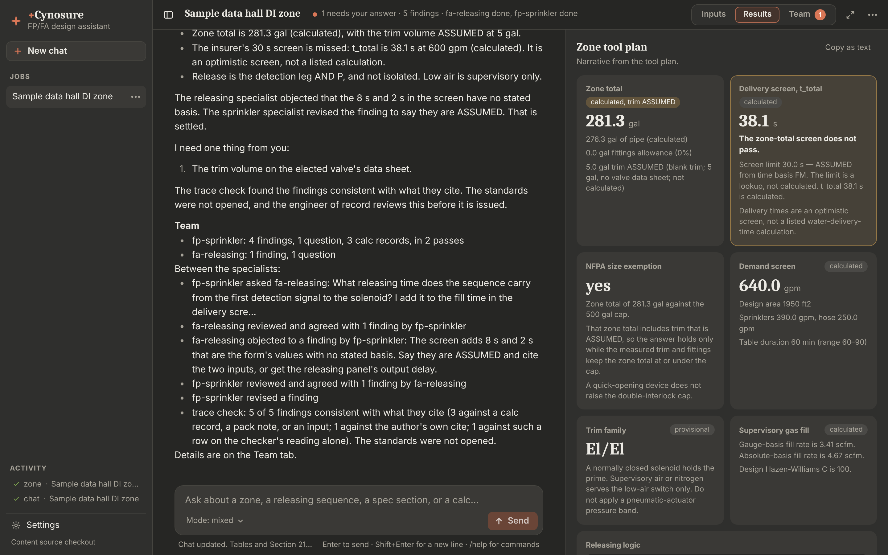
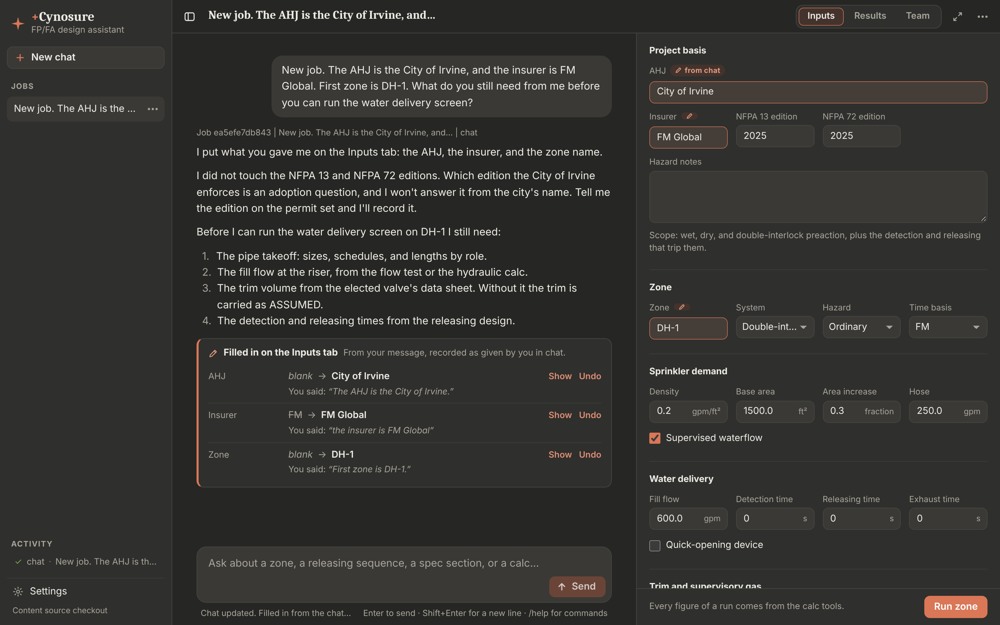

# +Cynosure

+Cynosure is a desktop design assistant for hyperscale data-center fire protection and fire alarm designers. It was called FP/FA Design Assistant until November 2026; the Python package, the data folder, and the environment variables keep the `fpfa` name, so an existing install keeps its jobs and its saved key.

## Start here

A short account of the whole thing, for when the rest of this file is too much. Everything below this section is the long form of what is said here.

**What it is.** A Windows program for laying out a fire sprinkler zone in a data center and writing down why. You type a question or fill in a zone's inputs, and it answers with a draft design basis for the engineer of record. Claude writes the words. Small Python programs, the calc tools, work out every number, so no gallon, second, or gpm in an answer is the model's own arithmetic.

**What you do with it.**

1. **Ask.** Type a question into the box at the bottom. With an Anthropic API key saved in Settings, a lead agent reads the method it needs and brings in the specialists (sprinklers, detection and releasing, the spec draft). Steps 2 and 4 of this list work without a key.
2. **Size a zone.** Open **Inputs** at the top right, enter the zone and its pipe, and press **Run zone**. **Results** then shows the figures as tiles: the zone total, the water-delivery screen and whether it passes, the demand, the trim family, and the releasing logic. Each tile says what in it is calculated and what is ASSUMED.
3. **Read what the team did.** **Team** lists what is waiting on someone first (a question for you, work that an input change left out of date, a disagreement between the specialists), then every finding with what it rests on.
4. **Export.** The ⋯ menu writes a draft Section 21 13 19 and a Design Basis and Open Questions document. Both are Word files, and both are drafts for the engineer of record.

To see all of it in a minute without typing anything, press **Try the sample** on the opening screen.

**What is in this repository.** Two things that ship separately, and the notes about them.

| Folder | What it is | Change it when |
| --- | --- | --- |
| `app/` | The program: the window, the record it keeps of each job, the exports | The program should behave differently |
| `skills/`, `roles/`, `modes/`, `calcs/`, `corpus/`, `specs/` | The content pack: the design methods as text, the calc tools, the draft spec sections. The program reads it when it runs and can install a newer one | What the program knows should change |
| `docs/` | The plan, the tests a person runs by hand, and what has and has not been proven | Deciding what to do next |

**Where it stands.** The program runs and its own tests pass. What nobody has done yet is watch the live model do the team's work: every test that involves an agent plays a script in the model's place. `docs/live-evaluation.md` is the path for that, about an hour by hand, and it is the most useful next step.

**To run it** from a checkout on Windows, in a terminal in the `app` folder: `py -m pip install -r requirements.txt` once, then `py -m fpfa`. "Run from source" below has the rest.

## Scope

Desktop prototype for hyperscale data-center fire protection and fire alarm designers. The scope is wet pipe, dry pipe, and double-interlock preaction sprinklers, plus the detection and releasing that trip them, and outdoor oil-filled transformer apparatus water spray (NFPA 15-style) in `skills/power-block-transformer-water-spray/SKILL.md`. Foam, clean agent, water mist, a building deluge system, and single-interlock preaction are out of scope. Canada ships only through a Country gate (US | Canada) on the skill. CAN/ULC-S524, S536, S537, S1001, and CEC Section 32 stay NEEDS HOLD. Apparatus water spray is not water mist and it is not a building deluge system.



The app-update views, `docs/screenshots/settings-app-update-clay.png` and `settings-app-update-linen.png`, show the real Settings screen with a synthetic 9.0.0 release result supplied by `app/tests/test_app_update_browser.py`. That version is a test fixture. The test covers the checking, available, failed, and current states and follows the download link to a local stand-in for the release page.

The other pictures are in `docs/screenshots`: `welcome-warm-clay.png` (the opening screen with its three ways to start), `team-warm-clay.png` (the Team tab beside the thread: a question waiting for the designer, then where the job stands), `team-across-linen.png` (the panel given the thread's place in the Linen scheme, with the findings under the tier each earned and one opened to what it rests on), `inputs-linen.png` (the Inputs tab), and `settings-appearance.png`, beside a picture of the old tkinter window from before the restyle. `py tests\docs_pictures.py` from `app` takes them again. **The reply and the team's rows in these pictures come from a scripted stand-in for the model** (`app/tests/team_scenario.py`), played through the real application. The Team block, the panel, and every label on them are written by the application from the record. No picture here is a live model's answer.

The v0 agent-team prototype plan, its decisions, and its acceptance tests are in `docs/prototype-plan.md`. The known answer for the sample zone is `docs/known-answer-dh1.md`. Coding agents start from `CLAUDE.md`.

## Where this stands

Version 0.3.2 closes what a second acceptance test, of version 0.3.0, found that 0.3.1 had not already closed (`NEXT-STEPS.md`, section 0b, reviews each of its findings against the source). A zone run is made on what the form holds or not at all: a density, a base area, a fill flow, a supervisory fill, or a fill time of 0 is refused, and so is a blank area increase or hose, each by name, and nothing puts 40 psig, 30 min, or 0 in place of what the designer typed. A figure given in SI is converted by the application, by the definitions alone, on a recorded calculation (`convert_units`), and the designer's own SI figure is refused in a field that takes US units. The trace check keeps the checker's reasons and shows them as its reading, reads a verdict line in any common form, and stops between its requests when Stop is pressed. The Team tab follows the team while a turn runs. A project record SQLite cannot read is named and moved aside only on the designer's yes, never deleted. Every text colour reads at 4.5:1 in every scheme. A spend limit is never sent again, a `retry-after` is waited out whole or not at all, Stop ends a wait to send a request again, and every request's id is kept on the job. By the owner's ruling, the lead goes on from "that's all I have" with stated, labeled assumptions, and stops only for a takeoff with no pipe data. None of it has run on Windows or against the live model.

Version 0.3.1 closes six things the acceptance test of version 0.2.0 found and 0.3.0 had not closed (`NEXT-STEPS.md` at the repository root reviews every finding of that test against the source). A trace check whose reply was cut off no longer becomes "Not supported" on every finding: nothing is written, the run is logged as not finished with what it cost, and a record is checked eight claims to a request. A job that states one edition of a standard while a calculation's own cites name another says EDITION NOT RECONCILED in place of "follows the project inputs", in the draft, the run's flags, and the Team tab. A finding the trace check supported is in the first group only when the application itself matched something in it to the rows it cites; otherwise it is in a new group that says only the checker's reading connects them. The figure rule reads more units, and a fact a specialist wrote is no longer shown to the checker as a project input. The trip time and the gas fill run on the takeoff's own zone total when a caller passes it rounded. The calc-code identity and the content fingerprint no longer change with a file's line endings. The Section 21 13 19 claim check's usage is on the job's record. None of this has been run on Windows or against the live model, and four items from the same review are still open: whether the Section export can open at all with the live checker, the evaluation's collaboration checks, the Design Basis table layout, and a pipe-only "passes" printed beside a zone-total "does not pass".

Version 0.3.0 is the hardening milestone. Two independent reviews of version 0.2.0 found that some of its checks could give a reassuring answer when the work underneath was wrong, out of date, incomplete, or not collaborative. This version closes those: a finding that still repeats an old number can no longer keep it current in a reply; the size exemption on every surface is the zone-total answer from one recorded row; no tier of assurance is named as a verification, and the export says which kinds of checking were never performed; a design basis with work missing says so at its head; a failed specialist keeps its usage and says what is partial; and the evaluation's checks are written so that a replayed calculation, a bare agreement, or a checker that approves everything cannot pass them. `docs/milestone-hardening-handback.md` reconciles every review finding and says what is still open. The releasing basis is still unverified against any standard and unreviewed by an engineer (`docs/releasing-basis.md`), and which copy of the skills is authoritative is the owner's decision to make (`docs/content-provenance.md`).

Version 0.2.0 was the team milestone: a designer hands the lead a plain objective, the lead plans and brings in the specialists, the specialists ask one another and review one another's findings, the job stays coherent when an input changes or the window is closed, and the exported draft says how far each statement was taken. What was built is described under "The team", "Project record", and "Design Basis and Open Questions export" below.

**None of it has been run against the live model.** Every test of the team uses a scripted stand-in for the model. Those tests show that the application can carry such a job: what each agent is told, what its tools do, what the record keeps, what the window shows. They cannot show that the model, handed a plain request, will plan, ask, object, and revise. `docs/live-evaluation.md` is the path for finding that out, by hand in about an hour and a half, or unattended with `python -m fpfa.live_eval`. `docs/acceptance-tests.md` has a table of what was tested, what was simulated, and what is unrun. `docs/milestone-team-handback.md` is the account of the 0.2.0 milestone as it was written, and `docs/milestone-hardening-handback.md` the account of this one. Five statuses are kept apart everywhere: software hardening, offline regression evidence, installed Windows evidence, live-model evidence, and engineering validation. Only the first two exist.

The app reads methods from `skills/`, calculations from `calcs/`, and optional draft language from `specs/`. It does not hardcode those methods. Point it at another folder with the same layout (`FPFA_CONTENT_ROOT`, or Settings). Settings can also check the release feed and install a newer pack. `corpus/` holds edition pins and decision notes. The everyday path searches them with `search_corpus`.

For the application itself, use **Settings → About +Cynosure → Check for updates**. The check reads stable `app-v*` releases from GitHub in the background, ignores content packs and prereleases, and compares their versions numerically. When a newer app is available, **Download update** opens that release’s page in your browser; download and run the installer when ready. The app is not replaced automatically. A failed check shows a retryable message. The content pack’s separate button is labeled **Check for content updates**. The app-release check currently uses GitHub’s API without a token. For a private repository, an installed copy needs authenticated release access or a public release feed; without that access it reports an error. This change does not configure GitHub authentication.

## Why this stack

Python, because the calc kernel that already exists is Python and the other design apps in this practice are Python. Numbers are computed in `calcs/` and exposed to Claude as tools.

The window is a web page in a native window, built the way Spec Surgeon builds its window. The Python engine is unchanged: `app/fpfa/desk.py` holds everything the window knows and does (the jobs, the form, the thread, the inbox, the exports, the slash commands, which project a result lands on), with no window toolkit. A small local server (`app/fpfa/web/server.py`, standard library only) serves the page and an API over it on `127.0.0.1`, and pywebview shows the page in Microsoft Edge WebView2 (`app/fpfa/web/shell.py`), the same engine as Edge, which Windows 10 and 11 carry. The page (`app/frontend`, React and TypeScript, built with Vite into `app/fpfa/web/static` and committed) only draws what the app's state says and posts what the designer does. Nothing leaves the machine but the model calls the designer asks for, the content-pack update check, and the manual app-release check.

Until November 2026 the window was the standard-library `tkinter` toolkit. It was slow: tkinter lays a long thread out on the CPU in Python, a resize reflowed the whole conversation, and the rounded look was made of generated pictures. Measured under Linux on one machine with a 60-turn thread, a resize took 191 ms there against 28 ms in the page, and opening the side panel (then a drawer named Zone details) 876 ms against 48 ms; a long job opens in about a tenth of a second, and the page lays out a turn only once it scrolls near the screen. AHJ Atlas's stack (Electron with a Node backend) was the other model in the practice; it would put a second runtime beside a Python engine, so it was not taken. `docs/prototype-plan.md` records the decision.

The server answers only on `127.0.0.1`, only to the page it launched: every API request carries a random launch token, a request whose Host is not that loopback address or whose Origin is another site is refused, and a request body is capped. Work that takes time (a narrated zone run, a chat turn, a claim check, a trace check) runs on the inbox's workers. Their results go onto a queue that one pump thread runs about thirty times a second under the desk's lock, so the rules run one at a time exactly as they did on the old window's main thread. The page hears every change on one event stream (`/api/events`): the state when it changes, the conversation only when the conversation changed, and the words of a reply that is arriving, sent as they come and never more than about thirty times a second.

The look is the practice's: the five colour schemes of Build-a-Spec and Spec Surgeon, colour for colour, as CSS tokens (`app/frontend/src/styles.css`), with the same values listed in `app/fpfa/theme.py` for the title bar and the window's first paint; a test keeps the two equal. The page uses only React; it fetches nothing from the network and needs no web font. `app/fpfa/shapes.py` still draws the app icon in pure Python.

The model is Claude Opus 5.5, model id `claude-opus-5-5`, called with the Anthropic Messages API and each user's own API key. That id is the one published on the Claude platform models page for Claude Opus 5.5. The client does not send `temperature`, `top_p`, or `top_k`. It does not disable adaptive thinking, and it does not force `tool_choice` (this model rejects a forced tool). Every request marks the system text as a prompt-cache breakpoint, and a request that carries tools asks for automatic caching on the message tail, so the rounds of one turn and the turns of one session read the shared prefix from the cache instead of paying full price for it each time.

A typed question is streamed. The window calls `messages.stream` instead of `messages.create`, with the same request: the same model, the same cached system block, the same cache marker on the message tail, the same tools, the same retry for a rate limit or an overload, and the same refusal to resend a request the API called too large. What comes back is the same message, so the tool loop, the record, and the usage totals do not know the difference. What changes is what the designer sees: the reply is drawn in the thread as it is written (see "How a reply arrives"). Tool definitions are not marked for eager input streaming. Every tool here takes a few scalars, the API keeps validating them, and the tool list stays byte-identical to the unstreamed call, so both read one cache entry. Every other request the application sends streams too, with nothing listening (`claude_client.streamed_create`): the zone narrative, the explosion-control starter, the trace check run from the Team tab, and the blind claim check. A request that is not streamed waits for the whole reply before a byte comes back, and at a ceiling of 64,000 output tokens a long reply would outlast the client's 300-second HTTP timeout and be sent again; a stream delivers as it is written. The zone narrative, the explosion-control starter, the blind claim check, and a specialist's or the checker's turn inside a chat turn are not drawn as they stream: the first two can be rejected in favor of the tool-plan text, and the others are not the reply.

The everyday path is how a typed question is answered. On a job, which is every question typed into the window, the turn is the lead of a team: its system text is `roles/lead/ROLE.md` from the content pack, the active mode file, the specialists by slug and description, the skill index, and the spec files. The lead reads a method with `read_skill` (`skills/<slug>/SKILL.md`) and delegates anything that sets a design basis to a specialist; it is not handed a specialist's role to wear and has no `read_role` tool (see "The team"). A content pack with no lead role falls back to the shell in `roles/everyday/ROLE.md` with a paragraph on the team tools, and a turn with no project record (how the tests drive the plain loop) uses that shell alone and lists the specialist roles for `read_role`. The modes in `modes/<slug>/MODE.md` (brainstorm, calculator, synthesis, and mixed) are picked by the application, not by the designer: a typed question is written in mixed, and a zone narration and the explosion-control starter in synthesis, the mode written for a draft after a tool plan (`modes_loader.CHAT_MODE` and `NARRATION_MODE`). The active mode file shapes that reply. The other modes are listed by their description, and the model reads one with `read_mode`. There is no Mode menu and no `/mode` command; a job saved while there was one keeps the mode it was left in, and nothing reads it. Those files stay in the content pack. Calc tools still run in `calcs/` through the same tool loop. `fa_calc` runs `calcs/fa/lib`. `search_corpus` searches `corpus/`. The fixed tool plan in `app/fpfa/workflow.py` still fills the tables and the docx when a narrative disagrees. This path does not add another model vendor, and it does not send the skills to a hosted container runtime.

Requests that fail for a passing reason are sent again. A rate limit, an overload, a timeout, or a dropped connection is retried up to five attempts in all. The wait is the API's own `retry-after` when it names one, waited out whole, since the API says an attempt before it fails, and otherwise 2, 4, 8, and 16 seconds. A `retry-after` longer than two minutes is not waited out: the request stops and says how long the API asked for. The wait is on the job's cancel, so Stop ends it at once. The working line says "waiting to try again" with the attempt number while it waits. A team turn makes dozens of requests, and one refused request must not lose the turn. A request the API called too large is never resent. Nor is one refused for money: the usage tier's monthly spend cap (a 429 the API marks `enforced_spend_limit_reached`, which fails until the next month), a spend limit set on the organization or the key's workspace, or a billing problem. The request stops at once and says so in plain words, with the API's own message, which says when access resumes.

`FPFA_EFFORT` (`low`, `medium`, `high`, `xhigh`, or `max`) adds `output_config.effort` to every request, on the streamed path and the plain one alike. It is unset by default, which leaves the model on its own default (medium on Claude Opus 5.5), and nothing in the app sets it. It is there so quality can be compared against time and cost on a live run; `python -m fpfa.live_eval --effort high` sets it for one run.

Spec files are loaded in full. Every `specs/*.md` file except the README is appended to the system text, sorted by file name, with its complete text. That system text goes on the everyday chat, the zone narrative, and the explosion-control starter. The app sets no file-count cap and no character cap on these files, and it does not summarize, skip, or shorten one. Earlier builds stopped after 12 files and cut each file at 16,000 characters, which dropped the end of Section 28 31 00 (all of §3.8, §3.9, and the closing paragraph). The eight files in this tree total about 50,500 characters, about 9,800 more than the old cap sent.

Loading specs in full increases token use, cost, and context use on every one of those requests. The tool loop sends the same system text on each tool round of a turn (up to 24 rounds for the lead, 20 for a specialist, 8 for a specialist answering another's question, and 16 on a turn with no record). That text goes out as one block with a prompt-cache breakpoint, so the first round of a turn writes the tool list and the system text to the cache at the cache-write rate, and the later rounds, and later turns inside the cache lifetime, read them at the cache-read rate. A request that carries tools also asks for automatic caching on the message tail, so a skill body or a tool result read on one round is cached for the rounds after it. A mode switch or an installed content pack changes the system text and starts a new cache entry. The blind claim check is one call with no tools, so it gets the system marker and no tail marker. A larger `specs/` folder in a content pack still raises the size of every request and the cost of the first round of each turn. The status line after a chat turn, a zone run, or a starter that called Claude shows the rounds, the input tokens, the share read from the cache, and the output tokens, so a cache that stops hitting is visible. The model's context window and the API request size limit still apply to the whole request; loading in full does not make the context unlimited. When the API rejects a request as too large (HTTP 413, or a 400 that says the prompt is too long), the reply or warning says so in plain words and includes the API's message. The app does not trim the request, drop a section, or resend a shorter copy, and the files in `specs/` are not changed. A too-large rejection is not retried. Rate limits and overloads are still retried with the same full request.

`max_tokens` caps what Claude writes in one response. Every request the application sends asks for 64,000 (`claude_client.MAX_OUTPUT_TOKENS`, set by the owner on 2026-11-12, up from 16,000): the lead, a specialist, a question between specialists, the zone narrative, the starter, the trace check, and the blind claim check. On Claude Opus 5.5 the ceiling covers the model's thinking and its reply together, and thinking cannot be turned off, so a reply that thinks at length had less room left to write at 16,000. The model accepts up to 128,000. It is a ceiling, not a target: a reply is billed for what it writes, and a typical reply is the same length at either figure. What a larger ceiling changes is the worst case: one runaway request can write four times as much before it stops (about $1.28 of output at the list price, against $0.32), and it can take longer. The API's output-tokens-per-minute rate limit counts only the tokens a reply actually writes; its documentation says `max_tokens` does not enter it, so the larger ceiling does not by itself bring more rate-limit waits. It is an output setting and is not a limit on the spec files. A reply the API reports as unfinished starts with an "Incomplete reply" line in the chat thread that names the `stop_reason` (`max_tokens`, `model_context_window_exceeded`, `refusal`, `pause_turn`, or `tool_use` when the tool-round limit ran out). On a zone run or a starter, the same line is listed under Warnings and Flags. A zone run's flags go into the Section 21 13 19 export, so the line is there too. The tables and figures stay on the tool plan either way. The blind claim check and the `/heavy` hosted path do not receive the spec files.

`/heavy` is the escape hatch for a heavy job. It is the only path that opens a Claude Managed Agents cloud session (a hosted container). That path is text-only reasoning on the already-computed zone packet in the message. The container is not given `skills/`, `roles/`, `modes/`, or `calcs/`, and it has no network to fetch them. The prompt does not tell the model to call `read_role`, `read_skill`, `read_mode`, or a calc tool. Those tools stay on the desktop Messages path. The model id on the session stays `claude-opus-5-5`. The reply is written back into the same project thread and labeled with the job. The hosted session is not a second conversation. Ordinary chat, Sample DI, Sample BESS, and a zone tool plan do not use it. The session is deleted when the job finishes. A failed delete is written to the `fpfa.managed` log and named on the reply. A delete that is still on the network stays tracked until that attempt finishes. Closing the window, and process exit, delete a session that is still polling or still being deleted. That sweep waits about a second so a slow network does not hold the window. The cached agent and cloud environment are reused for later heavy jobs in the same process. They are not deleted with the session.

Deterministic math is never left to the model. The double-interlock screen runs a fixed tool plan on the form. Claude may call the same tools and write the narrative. If that narrative does not quote the tool-plan volume and delivery time, the export keeps the tool-plan narrative and the tables. The rejected model draft is not written beside them. A delivery time from these tools is an optimistic screen. It is not a listed water-delivery-time calculation.

## Run from source (Windows)

Install Python 3.11 or newer (3.12 is what this prototype was exercised with), then:

```bat
cd app
py -m pip install -r requirements.txt
py -m pip install pywin32
py -m fpfa
```

`requirements.txt` includes pywebview, which brings pythonnet on Windows; the window is WebView2. The built page is committed in `app/fpfa/web/static`, so a source run needs no Node.js. `py -m fpfa --theme linen` opens the window in one of the colour schemes for that run (`clay`, `blueprint`, `graphite`, `carbon`, `linen`). Settings saves the lasting choice. `py -m fpfa --browser` opens the page in the default browser instead of the app's window, and does so by itself when pywebview has no window backend on the computer (WebView2 missing, or Linux without GTK or Qt); the server then runs until Ctrl+C in the terminal. In the browser the Save dialog is the one thing missing, so an export is written to `Documents\Cynosure exports` (or the data directory) under its suggested name, never over an existing file, and the status line names the path. `py -m fpfa --serve --port 47011` serves the page and prints its address without opening anything.

To change the page, install Node.js 22 and, from `app/frontend`, run `npm ci` once, then `npm run build`, which type-checks the page and writes `app/fpfa/web/static`; commit that folder with the change. `npm run dev` serves the page with hot reload on port 5173 and sends `/api` to an app started with `--serve --port 47011` (`CYNOSURE_API` names another address); open the address `--serve` prints with the port changed to 5173. `npm test` runs the page's own tests.

To look at the window after a change, shoot it in the colour scheme to check, at a device scale above 1. The tool needs Node.js and Playwright for Node.js, which is installed on its own: it is not one of the page's dependencies. In one terminal, from `app`:

```bat
set FPFA_DATA_DIR=%TEMP%\cynosure-pictures
py -m fpfa --demo --serve --theme linen
```

That loads the sample job, serves it in Linen, and prints the page's address. In a second terminal, from `app\frontend`:

```bat
node tools\shoot.mjs "<the address it printed>" pictures linen 2
```

That writes `thread-linen@2x.png`, `di_zone_inputs-linen@2x.png`, and `di_zone_results-linen@2x.png` into `pictures`, at 2880 by 1800. Quote the address: it holds an `&`. The scheme and the scale are optional. With neither, the pictures are `thread.png`, `di_zone_inputs.png`, and `di_zone_results.png` at 1440 by 900, the ones `--demo --screenshot-dir` writes. The scale is a device scale factor from 1 to 5, so a display at 150% is 1.5. The page draws the scheme the app serves, whatever its address says, so the tool reads the scheme the page drew before each picture. When it is not the one named, the tool stops with exit code 1 and says to serve that scheme with `--theme`: a picture it writes is always in the scheme its name gives. A wrong argument stops it with exit code 2 before a browser opens. The tool never changes the scheme Settings saved. `--demo` adds the sample job to the data directory it runs on and sets that directory to keep the API key in a file, which is why the commands above give it a folder of its own.

`pywin32` lets the `keyring` package store the API key in Windows Credential Manager. If Credential Manager is unavailable, the app stores the key in a user-only file under `%APPDATA%\fpfa-assistant`. Settings and the status line say which store holds the key. The key is not written into the project file, the chat log, or the exported document. A source run reaches `keyring` through a short-lived child Python process (`py -c ...`), so a keyring that never answers times out instead of hanging the window. The window reads the key once at launch and keeps it, so a click never waits on that process; saving or clearing the key in Settings reads it again, and while no key is kept the store is asked again each time one is needed.

On Linux or macOS the same commands work with `python3` in place of `py`. The key is stored in a user-only file under `~/.local/share/fpfa-assistant` (or `$XDG_DATA_HOME`), mode `0600` where the filesystem allows it. Set `FPFA_USE_KEYRING=1` before starting the app to use the system keyring instead. A missing keyring on those desktops can open a blocking password dialog, so the file is the default there.

Projects are JSON files in that data directory. Override it with `FPFA_DATA_DIR` if you want them somewhere else.

## Content updates

Settings shows the content version, **Check for content updates**, and a short changelog. The check reads a manifest, downloads a newer zip, verifies sha256, and then points the saved content folder at the new tree. Until that pointer moves, the app keeps the last good pack. If the saved folder is missing or incomplete, the app uses the bundled seed: this checkout when you run from source, or the seed folder shipped with a packaged app.

The API key and the project files live in the data directory. A content update leaves them there.

The default feed is the `manifest.json` asset on the latest GitHub Release:

`https://github.com/Abe-Borg/fp-fa-content/releases/latest/download/manifest.json`

A static URL that serves the same JSON works for a mirror or a test. The feed can also be the GitHub API document for the latest release (`https://api.github.com/repos/Abe-Borg/fp-fa-content/releases/latest`). The app then downloads the `manifest.json` asset named in that document. The manifest lists `version`, `created`, `sha256`, `filename`, and `changelog`. `min_app_version` is optional.

`FPFA_CONTENT_FEED_URL` overrides the feed for this process. `FPFA_CONTENT_ROOT` pins the content folder, and a check leaves that folder in place. `FPFA_CONTENT_UPDATES=0` skips the launch check. A packaged app checks on launch. A source checkout checks on launch after a feed has been saved, or when the feed override is set. Offline, the window still opens and the last good pack stays in place.

Installed packs live under `content-packs/` in the data directory. The app keeps the current pack and one previous pack. The everyday path searches `corpus/` with `search_corpus`. The pack still carries that folder.

## Release pack

Build the zip and manifest from this checkout:

```bash
python3 scripts/build_content_pack.py --version 2026.10.1 --out dist --changelog "Short note"
```

The zip includes `skills/`, `calcs/`, `corpus/`, `specs/`, `modes/`, and `roles/`, plus `pack.json`. The build omits `app/`, project files, API keys, `__pycache__`, `_sources`, and path names for foam, clean agent, Canada, and vendor catalogs. Scope-lock sentences that name those systems as out of scope stay in the skill files. The manifest sha256 is the zip file.

Pushing a tag `content-v2026.10.1` runs `.github/workflows/content-pack.yml`, which publishes `manifest.json` and the zip as Release assets. The tag message becomes the changelog when it has text. A chat command that opens a curation pull request is not wired.

## Packaging

From `app/` on the machine that should run the app:

```bat
py -m pip install -r requirements.txt pyinstaller
py packaging\build_app.py
```

On Linux or macOS, use `python3` in place of `py`. PyInstaller builds for the OS it is running on, so a Windows `.exe` comes from a Windows run (`app\dist\Cynosure\Cynosure.exe`, or `packaging\build_app.ps1`). A Linux run writes `app/dist/Cynosure/Cynosure`. The folder includes a seed content pack, and the packaged app checks the release feed on launch. Smoke that Linux binary with `FPFA_CONTENT_UPDATES=0 ./dist/Cynosure/Cynosure --demo --quit` from `app/`. That runs the seed pack and the sample tool plan. It does not produce `Cynosure.exe`. `python3 packaging/build_app.py --seed-only` writes the seed folder and stops before PyInstaller. On Windows, `packaging\build_app.ps1` then `packaging\build_installer.ps1` writes `app\dist\Cynosure-Setup-<version>.exe` (Inno Setup 6). Pushing a tag `app-v*` (for example `app-v0.1.1`) runs `.github/workflows/windows-app.yml`, which publishes that setup exe and `Cynosure-windows-<version>.zip`. The tag's version must equal `__version__` in `app/fpfa/__init__.py`. The same workflow can be run by hand from the Actions tab: leave `version` empty to read it from the code, and turn `publish` off to build without a release. In that mode the installer and the zip are uploaded as a workflow artifact named `Cynosure-windows-<version>-<sha>`, kept for 14 days, and nothing is tagged. That is how `docs/acceptance-tests.md` gets an installer from a branch. Content packs stay on `content-v*` tags.

The build puts the license terms in the folder. After PyInstaller finishes, `build_app.py` copies the repository's `LICENSE` into the folder as `LICENSE.txt` and writes `THIRD-PARTY-NOTICES.txt` beside it, so the installer and the portable zip both carry them (see "License"). A bundled package with no license text fails the build. `python3 packaging/third_party_notices.py --check` runs that check on its own, before the long build; the Windows workflow does. `--skip-notices` leaves the notices out for a local trial, and a folder built that way must not be distributed. The exe, the installer, and the shortcuts carry the app icon, `app/packaging/assets/Cynosure.ico`: the four-point star from the window on a rounded square. `python3 packaging/make_icon.py` redraws it. The build also copies the package metadata of `anthropic`, `python-docx`, and `pywebview` (and `pywin32-ctypes` and `pythonnet` on Windows) into the bundle, so **About and versions** in a packaged app reports their versions instead of "not installed".

The window goes into the bundle too. `build_app.py` adds the built page (`app/fpfa/web/static`) as data and refuses to build when it is missing, collects pywebview whole together with pythonnet and clr_loader on Windows (pywebview picks its WebView2 backend at run time, where PyInstaller cannot see it, the way Spec Surgeon's spec collects it), and excludes tkinter, so no Tcl or Tk ships. The Microsoft Edge WebView2 runtime is not bundled: Windows 10 and 11 carry it and keep it updated. On a machine without it the packaged app opens its page in the default browser instead. The build machine needs no Node.js, because the page is committed already built.

The installer upgrades an install made under the old name in place. Its AppId is unchanged, so Setup finds the earlier install, removes `fpfa.exe` and the "FPFA App" shortcuts, and leaves `Cynosure.exe` and a "+Cynosure" shortcut. A new install goes to a `Cynosure` folder. The data folder (`%APPDATA%\fpfa-assistant`) is not touched either way.

The packaged app cannot start a child Python for `keyring`, because there `sys.executable` is `Cynosure.exe`. Relaunching it only re-opened the app, which rejected the `-c` argument, so every save fell back to the user-only file. A frozen build therefore calls `keyring` inside its own process on one worker thread with the same timeout (8 s on Windows). That thread runs calls in the order they were made. A call that timed out still runs before any later call, so a slow delete cannot remove a key saved after it. If Credential Manager does not answer, the key still lands in the user-only file and the status line says so. `packaging/build_app.py` copies keyring's package metadata (its backends are found through entry points), collects `keyring.backends`, and on Windows adds `keyring.backends.Windows` and `pywin32-ctypes` (`win32ctypes`), keyring's own Credential Manager dependency. PyInstaller 6 hooks already collect these. The explicit flags guard against a hook change. The packaged app does not need a separate `pywin32` install. Credential Manager storage from the packaged `Cynosure.exe` still has to be confirmed on a real Windows machine: save a key in Settings, check that the status line names Windows Credential Manager, and look for `fpfa-assistant` under Control Panel > Credential Manager > Windows Credentials.

## Conversation-first window

The chat thread is where work happens. Open the app, type a question, press Enter. You do not have to fill in a form or run a sample first.

The window has four parts, and two of them can be put away. The job list hides and shows from the button at the left end of the top bar, or Ctrl+B. The job panel on the right opens from its three tabs at the right end of the top bar. The app remembers how you left both, and the panel's width, for the next launch.

- **Job list (left).** The +Cynosure wordmark and star, **New chat**, your jobs under it, and **Settings** at the bottom with the content pack's line under it. With no job yet, the list says how one starts. When no API key is saved, Settings carries a **No API key** mark. A new chat takes its name from your first question (for example "How should I split a 40,000 ft2 data hall into…"); a name too long for the sidebar is cut with an ellipsis, and the open job has a rounded highlight. Right-click a job, or use the ⋯ that shows on the job's row, to rename or delete it; with a job focused, F2 renames it, Delete deletes it, and the arrow keys move between jobs. Deleting asks first. Deleting the open job clears the thread. **Activity** appears above Settings once a job has run. It lists zone runs, chat turns, claim checks, and heavy jobs, each with a mark for its status (○ queued, ● running in the accent colour, ✓ done, ! error or interrupted, ✕ cancelled), its kind, and its job name.
- **Thread (middle).** Your messages and the replies, in one readable column that stays centered. A message you typed is a rounded bubble on the right; right-click it to copy it. A reply is plain text on the window colour, rendered from markdown: headings in the serif display face, bullets, numbered lists, **bold**, `code`, and fenced code and tables on a paper-coloured block, tables as real columns in the monospace font with a ruled header. Every line of a reply stays a line, so figures the model puts on consecutive lines read that way. Single asterisks and underscores are left alone, so names such as `t_total` stay intact. Each reply starts with a small caption naming its job (`Job <id> | <project> | <kind> | <title>`; a chat reply's caption stops at the kind, because the question is right above it). While a job for this project is queued or running, the last line of the thread is three pulsing dots, "Working on it…", and a few words on what the app is doing. Right-click the thread for Copy, Select all, and Copy the whole conversation (your messages included); with the thread focused, Ctrl+A selects it and Ctrl+C copies. Typing while the thread has the focus goes to the composer.
- **Top bar.** One bar across the thread and the panel: the job-list button, the job name, one line on the team, the panel's three tabs (**Inputs**, **Results**, **Team**), and the **⋯** menu. The menus are drawn by the page in the window's colours. Once a team has worked on the job, the line beside the job name says what is waiting first (how many questions need your answer, how many rows are out of date, how many disagreements are open), then the count of findings and who has worked, with a dot in the accent colour while something is waiting. It is a button; a click, or Enter with it focused, opens the Team tab. The Team tab's own button carries the count of what is waiting whether the panel is open or not. A long job name gives way last: the line beside it shortens first.
- **Job panel (right).** Inputs, Results, or Team, beside the thread. It is described under "The job panel" below.

The window works from the keyboard as well as the pointer. Tab and Shift+Tab move between the controls, and the control they reach wears a ring in the accent colour (on an accent-coloured button, drawn inside it in the colour of its text). The ring is for the keyboard only (the page's `:focus-visible`): a click gives a control the focus without it, so no ring is left on the last button you clicked. With **⋯** focused, Space or Enter opens its menu with the first row already chosen, and Down opens it too. In a menu, Up and Down move over the rows that can be chosen (a greyed row is passed over), Home and End go to the first and the last, Enter or Space chooses, and Esc or Tab closes it without choosing. Closing a menu puts the keys back on the button that opened it. In the composer Tab leaves the box, as in any web form. Tab stops once on the panel's three tabs, the Left and Right arrows walk them, and Enter or Space opens the one that has the focus, or closes the panel if it is the open one. The panel's edge takes the focus too: Left and Right size the panel, Home and End take it to its widest and narrowest, and Enter gives it back its own width. A start card on the opening screen, a group of findings, a finding, and an exchange row are all reached with Tab and opened with Enter or Space. A dialog keeps the focus while it is open, Tab stays inside it, and Esc closes it.

The composer is multi-line, in a rounded card whose edge takes the accent colour while you type. Enter sends, Shift+Enter adds a line, and the box grows as you type, from one line to eight. Under the words, inside the card, **Send** sits on the right, with **Stop** beside it while a job on the open job is running. There is no Mode menu: how a reply is written is picked by the application (see the everyday path above). One line under the card says what the app last did, with the keys beside it. The cursor starts in the composer when the window opens. Ctrl+S saves the open job, Ctrl+N starts a new chat, Ctrl+B hides or shows the job list, and closing the window saves too.

Above the composer there can be one-tap suggestions. On an empty thread they are **Load the sample zone**, **Show the commands**, and, once a key is saved, a starter question. After a zone has run and before you have typed a question, they are **Design basis**, **Explain the screen**, and **Questions for the engineer**, each a question about that zone. On a job a team has worked on, they follow what is waiting: **Continue with my answers** after you answered a question on the Team panel, **Bring it up to date** when an input changed and something still rests on the old value, **Finish what was interrupted**, **Settle what is open** when the specialists are not agreed, and **Where things stand** (which is `/status`) when you open a job and have not typed yet. A suggestion sends exactly the message it stands for, as if you had typed it, so the slash commands and the questions go down the paths they always did. Typing a question of your own on a quiet job, or a job in flight, clears them. The app writes these suggestions from the record; the model does not.

While a job on the open project is queued or running, **Stop** appears beside Send. It is the same cancel as **Cancel running job**, which the Team tab shows while a job runs: the turn stops before its next model round, and a round or a tool already in flight finishes.

An empty thread shows a short welcome in the middle of the room it has, and under it three cards, each a way to start: **Ask a question** puts the cursor in the composer, **Size a zone** opens the Inputs tab, and **Try the sample** loads the sample double-interlock zone. When no API key is saved, a link above the cards opens Settings. The sample is optional and never required before a question. The cards' words are the app's (`WELCOME_CARDS` in `app/fpfa/desk.py`); the page draws them.

The **⋯** menu holds everything else: Sample DI zone, Sample BESS room, Run zone, Export draft Section 21 13 19, Export Design Basis and Open Questions, Team panel, Where this job stands, Usage and cost, Narrate zone runs with Claude (on by default once a key is saved), Rename job, Settings, Commands, and About and versions. On launch the only plain buttons besides the top bar and the three start cards are New chat, Settings, Mode, and Send.

Rename, delete, and every message the app shows (an export that needs a run first, a value that is not a number) are dialogs in the window's own colours rather than grey system boxes. The file-save dialog is still the system's: the Windows Save dialog, which opens on a thread of its own so the window keeps drawing while it is up.

### The job panel

The job panel is the right-hand part of the window. Its three tabs are in the top bar: **Inputs**, **Results**, and **Team**. A tab opens the panel on itself, and pressing the open tab again closes it. The panel is closed on a first launch. After that it opens the way you left it, and it opens on Results by itself when a zone run lands on the open job, unless you are typing in one of its fields at that moment.

The panel sits beside the thread and takes a little under half of the room they share, never more than 720 pixels of its own accord. Drag its left edge to size it (the edge shows a line in the accent colour under the pointer), or give the edge the focus and use the arrow keys; a double click, or Enter on the focused edge, gives the panel back its own width. The thread always keeps at least 380 pixels. The button between the tabs and the ⋯ menu gives the panel the thread's place and brings the thread back; that is for the moment and is not remembered, so a launch always opens on the thread. What is in the panel lays itself out by the panel's own width, not the window's: fields go from two to a row to four, the figures from two to a row to as many as fit, and across the window the Inputs tab sets the pipe beside the rest and the Team tab sets the history beside the findings.

**Inputs** is the project basis and the zone on one page, in the groups a zone is described in: Project basis, Zone, Sprinkler demand, Water delivery, Trim and supervisory gas, and Pipe. A field's unit sits inside the field. A choice reads in words (NC solenoid for `nc_solenoid`) and keeps the value the app stores. Every field is optional. **Run zone** stays in a bar under the form however far the form is scrolled, and it posts the run into the thread like `/run`; when a field changed after the run that Results shows, the bar says so beside the button. Under the pipe table, "What a run takes as given" says what a blank trim and the time basis's screen limit will be taken as, in the app's words. The form keeps its values when the panel is closed. What you type reaches the app a quarter of a second after you stop, and every action (send, run, switch jobs, save) waits for the last of it first, so a run always uses the form as it is on screen. If the fields cannot reach the app, the action is not done: a message says so, and the edits stay on screen and go with the next try. A segment is added from the row under the table (Enter in its fields adds it too; the pipe ID comes from the calc pack) and removed with the ✕ on its row.

**Results** shows the last run as figures (`app/fpfa/results_panel.py` builds them; `app/frontend/src/components/Results.tsx` draws them). Each tile is one figure with the label it carries: the zone total (calculated, and trim ASSUMED when the trim was blank), the delivery screen's t_total with the screen limit and, in words, whether the zone-total screen passes, the NFPA size exemption, the demand screen, the trim family with its status, the supervisory gas fill, and the releasing logic. A screen that does not pass has an edge in the warning colour and says so in a sentence, so the colour is never the only signal. A figure the tool returns on two bases and elects neither, the gas fill, has no headline number. Nothing on a tile is computed by the window: every number is a field of a calc tool's output, printed with the rounding and the words the narrative uses, and a test holds each tile to the tool output and to the narrative. Under the tiles are what the run assumed, its flags, the narrative, and the tool transcript, closed until it is wanted. **Copy as text** copies the whole run as plain text. Before any run the tab says so and offers the Inputs tab and the sample. When a field changed after the run, a note above the figures names the inputs that moved and offers **Run zone again**: the figures are then a run on other inputs, the lead is told they are out of date instead of being handed them as governing, and Section 21 13 19 is not written from them until the zone is run again. The explosion-control starter shows its governing figures as the sentences the LFL tool plan wrote, with no tiles.

**Team** is described under "The team" below.

WebView2 draws the page at the display's scale, so text is sharp at 125%, 150%, and 200%. Fonts are Segoe UI for text, Georgia for the wordmark and headings, and Cascadia Code or Consolas for code and tables, with a fallback on other systems. The window opens maximized. The title bar takes the scheme's colours on Windows 11 and switches between dark and light on Windows 10 (1809 and later), when the window first shows and whenever the scheme changes; an older build keeps its own title bar.

### Inputs from the chat



The Inputs tab is one way to give the job its inputs; saying them in a message is the other. "The AHJ is the City of Irvine" or "the pump test came back at 750 gpm at the riser" is put on the form by the lead's `set_input` (described under "The team" below), and the window shows what changed:

- **On the form at once.** A field takes the value the moment the lead records it, while the team is still working, not when the reply ends. Under the working line, **Filled in so far** lists each one; a press on one opens it on the Inputs tab. A field you are typing a different value into keeps what you typed: when the reply ends your edit replaces the lead's row, as it always did, and the card says the field was changed since. While a number on the form does not read as one, nothing is put on the form until the reply ends, so nothing you typed is lost.
- **A card under the reply** lists every field the turn filled in: the field's name as the tab writes it, the value before and after, and the words it came from. **You said** is used only when the application finds those words, as written, in one of your messages (`desk.said_by_designer`, which sets aside case, quote marks, punctuation, and spacing). Otherwise the line reads **The lead's note**, because the reason is the lead's and not a quote. **Show** opens the Inputs tab on the field with the focus in it. **Undo** puts back what the field held before, as your own edit: the record keeps the lead's row as history and adds yours, so nothing is erased. A field you typed over since is left as it is, and the card says it was changed. When the last zone run used the old value, the card says the Results tab no longer describes the form and offers **Run zone**. That note is read from the run each time the card is drawn, so it goes once the zone is run on the new value.
- **The field keeps a mark.** A field the chat filled in carries a pen tag beside its label, and the field is tinted, until you type over it; then the value is yours and the mark goes. In a narrow field the tag is the pen alone, so the label keeps its room. A press on the tag says where the value came from and what the field held before; Escape closes it. A field filled in while you were looking is highlighted for a moment.
- **The Inputs tab is marked** with a dot when the chat filled something in while another tab was open or the panel was closed.
- **The next turn knows.** The lead's next message carries the card in the application's words, with what became of each row (on the form, undone by you, changed by you since, applied, or skipped), so the lead does not go on believing a value you put back.

**Ask me first.** Settings, **Inputs from the chat**, has two choices. **Fill them in at once** is the default and is described above. **Ask me first** keeps everything off the record and the form: the lead's `set_input` proposes, its result tells the lead the value waits for your OK, and the card under the reply reads **Fill these in on the Inputs tab?** with **Apply** and **Skip** on each row and **Apply all** when there are several. Apply writes the row the way `set_input` would have, as given by you in chat and applied by you, and the field fills and is marked; an applied row has Undo like any other. Skip leaves the record and the form alone. The choice is saved in `config.json` and applies from the next message.

The lead records only what you stated. It does not fill a field from what it infers: an AHJ's name does not give the edition of NFPA 13 it enforces, and the scripted reply in the picture says so. Whether a live model reliably notices an input mentioned in passing has not been tested; the tests play a scripted lead.

### Appearance

Settings, **Appearance**, has the five colour schemes of the practice's other apps, colour for colour: **Warm Clay** (the default: warm charcoal, cream paper, terracotta), **Blueprint** (deep navy, drafting blue), **Graphite & Teal**, **Carbon & Hi-Vis** (true black, safety orange), and **Linen** (the one light scheme). Each card previews its scheme in that scheme's own colours. A click recolours the window at once and saves the choice in `config.json` in the data directory, so it is the scheme the next launch opens in; the window's background before the page paints is that scheme's too, so a light scheme never opens on a dark frame. Tab stops at each card, and Space or Enter picks the focused one. The card in use has an accent edge; a hover changes only the edge, so the card's text never sits on a mismatched patch. `FPFA_THEME=<id>` or `--theme <id>` overrides it for one run. In every scheme the text reads at 7:1 or better on the window, the sidebar, and a card, secondary text at 4.5:1, and the document-like surfaces (the tool transcript on the Results tab, code and table blocks, the license) stay near-white paper with dark text.

Every colour that draws text reads at 4.5:1 or more on the window's background, its panels, and its cards, in all five schemes: secondary text in the dimmer ink, and an error, a warning, or a link mixed toward the ink so it keeps its colour. The faintest ink is kept for what is not text, such as borders and separator dots. A test reads the stylesheet and holds every text colour to that. Text on the accent itself is the one exception: Warm Clay's white on terracotta is 3.1:1, and the brand colour is the owner's to change.

**Reduce motion** on the same panel shows each reply at once, with no easing, no pulsing dots, and no shimmer. `FPFA_REDUCE_MOTION=1` does the same for one run, and so does the reduce-motion setting of Windows itself.

### How a reply arrives

A reply does not appear all at once after a silent wait. While the model works, the working line under the thread says what the app is doing in a few words: thinking, reading a named skill, role, or mode, searching the corpus, running a named calc tool, reading or writing the project record, handing off to a named specialist (and then that specialist's own steps, prefixed with its slug), one specialist asking another, a review of a finding, recording a project input, setting out the plan, settling a disagreement, running the trace check, or waiting to try a refused request again. The line names the tool or the file. It never shows a tool's inputs or its result, so no figure is on screen before the reply states it with its label.

When the lead starts writing, its words are drawn in the thread as they arrive, under the job's caption, with a caret after the last word. They come onto the screen at a reading pace instead of in network bursts, and the newest words fade in from the window colour. Bold and code are drawn as they will end up while they are still half written, so nothing jumps. A reply is drawn block by block, split at its blank lines: a block that has settled is drawn once and never again, and only the one still growing is drawn each frame, so a long reply stays cheap to draw. If you scroll up to read, the thread stays where you put it until you scroll back to the end, and a **Latest** button below the thread brings you back. That holds however you scroll: the wheel anywhere over the thread, the scrollbar (a press in its trough moves the thread before any release), and Page Up, Home, and the arrow keys. While you are at the end the thread stays there: whatever makes it taller (a new turn, a word, a table taking its width) keeps the last line in view. A specialist's and the checker's words are never drawn in the thread: they are record rows and a Team block, as before. If the lead writes a line before it calls a tool and then writes its answer in a later round, the later text replaces the earlier, because the reply that is saved is the text of the last round that wrote any. If a streamed attempt fails and is sent again, the words of the failed attempt are removed before the new ones arrive.

When the turn ends, the reply is saved on the job exactly as before, with its caption and its Team block, and the thread carries on from the words already on screen instead of redrawing them. A reply that arrives whole (a zone run's tool-plan narrative, a slash command, a claim check, an error) eases in the same way: 800 characters take about a second. Opening a saved job draws its thread at once. The pacing rules are the ones Spec Surgeon uses (`app/frontend/src/reveal.ts`, a copy of its rules).

- `/sample-di2` loads a second sample zone, DH-2, into a job of its own the same way. Its pipe alone is under the 500 gal cap and its zone total is over it, its trim and fittings allowance are entered and not assumed, and it has no manual release station, so its answers differ from the first sample's. `docs/known-answer-dh2.md` is its expected basis, the wrong answers to look for, and its pass criteria.
- **Sample DI** (the welcome link, ⋯ → Sample DI zone, or `/sample-di`) creates the sample data-hall double-interlock job and runs the existing zone tool plan. It opens its own job. It does not write over the thread you were in. That path does not need an API key. The reply starts with a line that says what was loaded ("Sample loaded: data-hall double-interlock zone DH-1 (4 pipe segments, FM time basis). This is sample data, not a real building…"), then the narrative, including the ASSUMED trim line and the ASSUMED screen limit. The zone inputs are filled in on the Inputs tab, and the same figures stay on the Results tab for export. Follow-up questions in that thread use those figures.
- **Sample BESS** (⋯ → Sample BESS room, or `/sample-bess`) creates a generic Li-ion BESS room and runs the explosion-control starter in synthesis mode. Its reply also starts with a "Sample loaded" line. That path does not need an API key. The method stays in `skills/ess-isolation-venting-and-duration/SKILL.md`. Mixture LFL and setpoints come from the LFL tool. An election or a duration the tool did not return is labeled ASSUMED. The sample room has no sprinkler zone, so the draft does not invent gallons or seconds. If that project already has a zone tool plan, the starter quotes it and those gallons and seconds govern when the narrative disagrees. Export of Section 21 13 19 still needs a zone run.
- `/run` (or **Run zone** on the Inputs tab, or in the ⋯ menu) runs whatever is on the zone form.
- `/new Job name` starts a named job. `/help` lists the composer commands.
- `/status` (or **Where this job stands** in the ⋯ menu, or **Status to thread** on the Team panel) posts where the open job stands into the thread: the objective and the plan, who did what, what the team needs from you, what is out of date since an input changed, what the specialists have not reconciled, starting values you have not confirmed, who was interrupted, what is open for the engineer of record, the state of the trace check, and whether the Design Basis can be exported. It is read from the record. No model is called, so it works without a key and costs nothing.
- **Export draft Section 21 13 19** (in the ⋯ menu) still needs a finished zone run. Before the file is written, the app runs the blind claim check from `skills/blind-claim-check/SKILL.md`. The QA checker is `roles/qa-specialist/ROLE.md`. That turn receives only the claim list and the short cites. It does not receive the draft, the spec section, or the designer's notes. Claims come from the narrative the export writes, including a figure with no section and a sentence that names a section a tool already named. A tool string may be shown as a package assertion. It is not a passage from the standard, and copying it back as the cite does not support the claim. Export waits until every such claim is Supported, and it is refused while the zone form has changed since the run the section would be written from, with a message naming the inputs that moved. That result does not mean the narrative was compared to the standard. Engineer-of-record review still applies. A cite marked `NOT PULLED` stays open. The check is a `claim` job on the inbox, labeled `Job <id> | <project> | claim | <title>`, and the result is posted into the same project thread. It does not open a hosted container. The draft section stays 21 13 19.
- A normal message, with a key saved, uses the everyday path and includes the earlier turns in that project. The window does not wait on the call. The question is saved on the job right away, and the reply is written into the thread when it arrives. The path can read a specialist role, a mode, and a skill, and it can call the calc tools. The Mode menu (or `/mode`) chooses brainstorm, calculator, synthesis, or mixed. If a tool plan has already run on the form as it is now, the request repeats those governing figures. If the form changed after that run, the request says instead which inputs moved, that the run's figures are out of date and must not be quoted, and that the zone has to be run again before the tables or the Section export are used. The chat reply does not replace the tables or the export. **Narrate zone runs with Claude** in the ⋯ menu decides whether `/sample-di`, `/sample-bess`, and `/run` also ask Claude for the narrative. Numbers in the tables and the export stay on the tool plan either way.
- The inbox (Activity, in the sidebar) is the queue of zone runs, chat turns, an explosion-control starter that calls Claude, a blind claim check, and a heavy job. Two workers run the long jobs. The composer stays usable while a job runs, including a second message and a switch to another project. A result that finishes later is labeled with its job id, project name, and kind, and it is written onto the project that started it. A local tool plan with no model call still finishes before `/sample-di`, `/sample-bess`, or `/run` returns, and it is recorded on the same inbox.
- `/heavy task` sends that task through the hosted runtime and posts the reply into the same thread. The turn is text-only reasoning on the zone packet already in the message. It does not call `read_role`, `read_skill`, `read_mode`, or a calc tool, and it does not recompute zone gallons or seconds. It does not open another project. A typed question, `/sample-di`, `/sample-bess`, and `/run` stay on the path they already had.
- Jobs are JSON files in the data directory. A first `/run`, `/help`, or chat message keeps whatever is already on the zone form. The sample zone is generic. It is not a constructed building.

Settings has four panels. **Appearance** has the colour schemes and Reduce motion (above). **Anthropic API key** has the key field, Save key, Check key, and Clear key, and says which store holds the key. **Content pack** shows the content version, Check for content updates, and What's new; the content feed URL and the content pack folder are under **Advanced**. **About +Cynosure** has the version, **Check for updates** for the app, the copyright line, the license in brief, and three information buttons: **License** (the terms this copy ships with), **Third-party notices**, and **About and versions**.

Blank trim (5 gal) and the screen-limit seconds are labeled ASSUMED on the Inputs tab, in the thread after a run, on the Results tab, and in the export. Pipe gallons and trip time are calculated. A value the designer types is not assumed. A designer judgment the tools did not return is labeled use best judgment. That label is not ASSUMED and it is not a calculated figure. A delivery time from these tools is an optimistic screen. It is not a listed water-delivery-time calculation.

Check key in Settings calls the models endpoint for `claude-opus-5-5` and does not generate text.

## Project record

Every job has rows in one SQLite database, `fpfa.db` in the data directory. The record is the durable store the agent-team prototype builds on (`docs/prototype-plan.md`, Phase 1). It holds facts (basis of design and assumptions, each with a label), evidence (cites with edition, section, a short paraphrase, and a status of held, NOT PULLED, NEEDS HOLD, or PACKAGE ASSERTION), calculation records, findings, reviews (one agent's position on another's finding), open questions, decisions, handoffs, tasks, agents, and an append-only event log. Documents are exports of the record. Nothing in the record is edited by hand.

Calc tools record themselves. When a zone run, a starter, or a chat turn calls `zone_trapped_volume`, `dry_delivery_screen`, `di_trip_to_water`, `density_area`, `hose_duration`, `nitrogen_gate`, `elect_di_trim`, `releasing_truth_table`, `resolve_pipe_id`, `lfl_setpoints`, `fp_calc`, `fa_calc`, or `convert_units` on a job, the tool, its inputs, its output, the content version, the identity of the calc code, and the caller (`tool-plan`, `narrator`, `lead`, or a specialist slug) are written as one calculation record. The record is keyed by a hash of the tool, the inputs, and the calc identity, which is a hash of the kernel files under `calcs/fp` and `calcs/fa/lib` in the running pack. A second call with the same inputs on the same job from the same calc code returns the recorded output and counts a replay instead of writing a second row. That is the duplicate prevention the recovery phase relies on. A content-pack update that changes a kernel file changes the identity, so the next call computes fresh and writes a new row; the old row stays as history with its pack version and calc identity, and the Design Basis export prints both beside each record's inputs. A result returned to a model context carries `record_id`, the id of its calc record, so a finding can cite it in `supports`; the fixed tool plan gets the bare output, so its tables and export are byte-identical to a run with no record. A tool session that has no record attached, which is how the calc tests and the form's pipe-ID lookups run, writes nothing and behaves as before.

The record tools sit beside the calc tools: `record_fact`, `record_evidence`, `record_finding`, `withdraw_finding`, `review_finding`, `open_question`, and `record_decision`. A finding or a decision is never edited: `record_finding` and `record_decision` take `replaces`, the id of the author's earlier row, which stays as history, and `withdraw_finding` retires a finding or a decision with the reason. `review_finding` records one agent's position on another's finding: agree, or object with a note. `open_question` takes `to`: `designer` for something the team needs from the person using the app before the work can go on, `engineer` (the default) for an RFI. `read_record` shows the job's record with row ids: each calculation record with its inputs and its scalar outputs, each evidence row with its document, edition, section, note, and status, and the findings, decisions, open questions, and pending handoffs. `read_record` with `kind` returns the full rows of one table, and with `kind` and `id` returns one row, so a later turn can pick the right calc record or cite by its contents. A fact, finding, or decision carries exactly one label: calculated, ASSUMED, use best judgment, or a cite class (CODE, OWNER, PRACTICE, PARA, HB). A fact can also be GIVEN, which marks a value the designer supplied; only the form and the lead write it, and a finding or a decision cannot carry it. A row with no label, or an evidence row with an unknown status, is refused and the model sees the refusal as a tool error. Rows written by the model carry the agent name of the context that wrote them.

Opening a job imports it into the record once: the basis fields become facts (editions as CODE, the insurer as OWNER, the AHJ and hazard notes as use best judgment) and the tool calls in a saved zone run or starter become calculation records. Deleting a job deletes its record rows. The record does not change the chat thread or the Section 21 13 19 export.

### Project inputs, and what follows them

**The limits, stated first.** The record reconciles a change by itself only for the eight tools of the double-interlock zone workflow, whose arguments it can tie to a project input (`coherence.BINDINGS`). A calculation from `fp_calc`, `fa_calc`, `lfl_setpoints`, or `resolve_pipe_id` is not tied to the inputs: the application cannot tell which input it used and never marks it out of date. It does not pretend otherwise. The tool's result says so to the specialist; the Design Basis prints "not tied to the project inputs" beside it; and when an input changed after such a calculation last ran, every view lists it as one the application cannot reconcile, a finding resting on it goes to the engineer's tier, and the document counts it as a gap. Reconciling it is its author's job or a person's: running it again clears the note, with the same arguments (the row is replayed, which is the author saying they still hold) or with others (a new row, and the old one is history once nothing current rests on it).

A calculation is also out of date when the calc code changed. Every calculation record keeps the identity of the kernel files that produced it. The record is told which content pack is installed (`Record.set_context`), and a calculation computed by other calc code is out of date, with that reason, until it is run again. A content update that touches a kernel file therefore leaves a job's figures out of date until the zone is run again, which is the careful reading of a figure produced by code that is no longer installed. A trace check made against one content pack has to be run again when the pack changes, because a cite is read in the pack. Both values, the calc code's identity and the content fingerprint, are hashed with line endings set aside (`calc_tools._identity_bytes`): a Windows checkout holds the same files with CRLF endings where a pack built on Linux holds LF, and it is the same code. Without that, a job run on the bundled seed would read as out of date after the first content update, with no line of the kernel changed.

**The edition a calculation's cites carry.** The tool plan does not tell the kernel which edition of NFPA 13 the job is on, and the kernel's cites are NFPA 13-2025, the baseline the pack is written against. So for each current calculation the application reads the edition its own output names and the edition the job states in its basis (`coherence.edition_gaps`), for NFPA 13 and NFPA 72. Where they differ, or the job names no edition or more than one, the row carries **EDITION NOT RECONCILED** with both labels and one open sentence: whether the rule and the section apply in the edition the job states was not resolved, and the engineer of record confirms it. The application compares two labels. It does not know whether the rule reads the same in both editions and never says so either way. The hold is not staleness: the figures still follow the zone inputs, nothing is run again for it, and running the zone again does not clear it, because the cites would not change. It clears when the job states the edition the cites carry. It is printed in the Design Basis where "follows the project inputs" would be, it is a coverage gap so that document opens INCOMPLETE DRAFT, it is the first flag of a zone run (in the thread, on the Results tab, and in the Section 21 13 19 export), and `/status`, the lead's status block, and the Team tab carry it. Whether the kernel should hold another edition's body is the content team's question, not the application's (`docs/content-provenance.md`).

The size exemption is the one figure that used to exist twice. The tool plan now hands the delivery screen the takeoff's own zone total, so the recorded row carries the zone-total answer and the narrative, the Results tile, and both documents print that one row. The screen follows the takeoff and goes out of date with it. A specialist that passes the zone total rounded cannot move the answer: the record ties the figure to the takeoff it came from within a tolerance, and the screen then runs on the takeoff's own figure and says so (`coherence.EXACT_FROM_SOURCE`), so a 500.3 gal takeoff passed as 500 is still over the cap. The trip time and the gas fill take the zone total the same way: `di_trip_to_water` and `nitrogen_gate` run, and are recorded, on the takeoff's own figure, so the same 500.3 gal passed as 500 cannot turn a 30.01 s trip time into a 30.0 s one that meets a 30 s screen, and a repeat of a call with the volume rounded replays the one row instead of writing a second. A volume that matches no takeoff is used as passed and marked as another case. A screen run with no zone total is a pipe-only screen: it says no when the pipe alone is over the cap, and otherwise gives no answer at all (`workflow.pipe_only_screen`). When the zone total includes an ASSUMED trim volume or fittings allowance, a yes is qualified in words wherever it is printed.

The inputs are on the record too (`app/fpfa/inputs.py`). Every zone field of the Inputs tab (the fill flow, the three times, the trim, the pressures, the pipe takeoff, and the rest) and the five basis fields is a fact with the label GIVEN (the basis fields keep their own labels) and a source that says who supplied it: `zone form` when the designer typed it, `designer, in chat` when the lead recorded it from the conversation, `sample data` for the sample job, and `zone form (starting value, not confirmed by the designer)` for a field still at the value a blank form opens with. That last one is not the designer's input, and the lead, the specialists' briefs, `/status`, and the export all name it as unconfirmed.

The form and the record are kept in step both ways, on every open, save, run, and chat turn. A field the designer changed writes a new row and supersedes the old one. An input the lead recorded from the chat with `set_input` is put on the form as soon as the tool finishes, while the team is still working (see "Inputs from the chat" above), and survives a kill between the turn and the save: the next launch shows the lead's value on the form and does not read the old one off it as a change. Whenever the record puts a value on the open form, the other fields stay as the designer has them, what was typed and not yet saved included. That holds for a basis field that was empty on the Inputs tab as well (the AHJ, the hazard notes): the value the lead recorded appears in the field and is saved with the job. A basis field the designer empties leaves the record. Its row is kept as history, and a finding that rested on it is out of date, with the reason, until the field is stated again. A number may be written with its own unit (`750 gpm`, `1,500 sq ft`) and a choice in any case; a number with another unit, or a percent on an input that is a fraction, is refused with what the input takes, so nothing is converted by guess.

Each calculation record keeps what it followed (`app/fpfa/coherence.py`): the input facts whose values it used, and the earlier calculation it took a figure from (a delivery screen takes its gallons from the volume). When an input changes, every calculation that used the old value is **out of date**, and so is every calculation that took a figure from one, every finding and decision that rests on one, and every cite that follows an edition that changed. Each says why ("q_fill_gpm changed from 600 gpm to 750 gpm"). Nothing is deleted and nothing is recomputed on its own. A calculation run on a value other than the project input is an **alternative**: it is marked as one where it is listed, the specialist that ran it is told so in the tool's result, and a finding that rests on it is shown to the lead as resting on a value other than the project input. A calculation that took a figure from an alternative is an alternative too, and says whose figure it took: a trip time on the gallons of a what-if takeoff is not the design case, even when every other argument is the project's own. When a figure matches both a result on the project inputs and an alternative, the call is tied to the one on the project inputs.

Out-of-date rows are brought current by the work that owns them: running the zone again replaces the tool plan's rows, and a specialist re-runs its calculations and replaces or withdraws its findings. Only a row that something current rests on counts as waiting on someone; a stale calculation nobody cites is history, marked where a model reads the record so it is not cited by mistake. Two contributors that record different values for the same fact both stay on the record, shown to the lead as a conflict, until the lead records the value that stands.

**What a zone run takes.** A run takes the form's values as the designer typed them (`workflow.validate_di`). It refuses a fill flow, a density, a base area, a supervisory fill, or a fill time that is not greater than 0, and an area increase or a hose allowance left blank, naming every problem at once in the form's words: "Density must be greater than 0 gpm/ft².", "Area increase is blank. Enter it as a fraction (0.30 is a 30 percent increase), or 0 when no increase applies." An area increase or a hose of 0 is an answer, and runs. The form keeps a 0 as 0 and a blank as blank, and nothing in the plan puts 40 psig, 30 min, or 0 in place of what was typed. The lead cannot record a 0 for those five from the chat either. Called directly, `nitrogen_gate` still takes 40 psig and 30 min when they are left out, and its description says so; a 0 passed to it reaches the kernel, which refuses it.

**Units.** Every calc tool takes the US units its field names state (gpm, ft², gpm/ft², psi, gal, ft, in). A figure given in SI is converted by the application, never by the model (`app/fpfa/units.py`), and by the definitions alone: the international foot and inch, the US gallon of 231 cubic inches, and the pound-force, so no factor is an engineering choice. `convert_units(value, from_unit, to_unit)` is a calc tool and records itself, so a converted figure has a row to cite. The row keeps each figure with its own unit, and the trace check and the reply audit hold a "1695.8 L/min" to a row that holds it in L/min, not to one that holds 1695.8 gpm. The figure a conversion was given keeps the unit it was given in on the row's inputs too, read as the conversion read it ("litres/min" is L/min), so converting 1695.8 L/min to gpm does not back a "1695.8 gpm". The lead records a figure the designer gave in another unit with its unit (`set_input` with "12.2 mm/min"): the application converts it to the form's unit on a recorded conversion and keeps both, the designer's own figure in the input's source. For the length of a chat turn, a calc tool any agent calls refuses the designer's own SI figure in a field that takes US units, before anything runs or is recorded, and says to convert it first. A gauge pressure stays gauge; an absolute pressure, a K-factor, and cubic feet are not converted. The Inputs form still takes its own units only.

## Design Basis and Open Questions export

**Export Design Basis and Open Questions** in the ⋯ menu writes a second Word document from the job's project record (`app/fpfa/design_basis_docx.py`). Every line is read from the record; nothing is typed by hand and nothing from the chat thread is copied in.

The document is built so an engineer can tell five kinds of statement apart without reading the code, and cannot take the document for more than it is.

It opens with **What this document covers** (`checker.coverage`). When the record holds a calculation no current finding rests on, a plan step that is not done, a specialist that failed or was interrupted, a handoff one specialist left for another that was never picked up, an unanswered question to the designer, an unsettled disagreement, or a calculation the application cannot reconcile, the section reads INCOMPLETE DRAFT and lists each gap. A calculation that only feeds another is spoken for with the one it feeds. The export is still written: a partial draft is useful. It is not allowed to look whole. When nothing is missing the section says so, and says that this is a statement about the record and not about the design.

Then a table of the **kinds of assurance**, in order: specialist output, model review, trace consistency, support from a row the application identified, verification against the primary standard, and qualified engineering review. The last two are marked NOT PERFORMED, on every document, because this application never performs them.

Then the five tiers and how many findings sit in each:

- **Trace-consistent with a row the application identified.** The trace check, a second pass by the same AI model, found the finding consistent with a calculation record, a content-pack note the application looked up, or a project input, and every figure in it is in those rows with its unit. The row is named beside it. It is consistency with the team's own record. It is not verification. A finding is here only when the application itself matched something in it to those rows: a figure with its unit, or the releasing record's own expression quoted in the finding.
- **Trace-consistent with an identified row, on the checker's reading alone.** The same kinds of row, and nothing in the statement the application could hold to them: no figure, and not the releasing record's expression. "The trim family is El/El" is one, and so is a statement about what releases the valve that is put in other words than the record's. Only the checker's reading connects the words to the row, and the application cannot tell a true statement of this kind from a false one. So none of them is in the first group, whatever the checker said.
- **Trace-consistent with its author's own cite only.** The application did not find that section in the content pack, so nothing independent of the author backs the cite.
- **Stated by a specialist, not checked.** No trace check has judged it.
- **Needs further evidence or engineering review.** Not supported by what it cites, without a source, objected to by another specialist, out of date, resting on a calculation the application cannot reconcile, or by its label an assumption or a judgment.

Three rules of the application's own stand whatever the checker says. A figure with a unit in a finding has to be in the rows it cites as that kind of quantity (`app/fpfa/quantities.py`): 900 gpm is not backed by a 900 ft pipe, and 281.3 s is not backed by a 281.3 gal zone. In a finding the rule reads every unit the application knows, each as a class of its own (feet, inches, amp-hours, volts, amps, litres per minute, hours, a count of rows or zones), so 99 Ah is not backed by a 99 ft riser and 600 gpm is not backed by 600 L/min. A ratio it does not know (gal/hr) is classed by its own spelling instead of counting as no unit; `g.p.m.` and `gal/min` are read as gpm; and a number written out before one of the eight original units ("nine hundred gpm") is read as that number. It still converts nothing, and a number with no unit beside it still backs anything. The reply audit reads the eight units it always read, and since 0.3.2 the SI flow, area, volume, pressure, and density units a metric job's reply gives (L/min, L/s, m³/h, m², L, m³, kPa, bar, mm/min). Low air is never a release input, and a finding that says otherwise is not supported, whatever it cites (`releasing.release_wording_hits`). A finding whose author's note only repeats it is not supported. Where a rule sets the checker's verdict aside, the check records that it did (`overruled`), and its status line says so: a checker that approves what a rule catches is a checker to distrust on the claims no rule covers. Whether a claim's meaning, conditions, and applicability follow from its cite is the checker's judgment alone, and the live checker's judgment is untested.

The last section, **Content the team worked from**, prints the content pack's version, its fingerprint (a hash of every method, role, note, and calc file), and the calc code's identity, and lists which contributor read which skill, a hash of the text it was given, whether the read came before or after its findings, and any cite it then recorded that the skill holds. A read shows the method was in front of the contributor. It does not show the method was followed.

The tier is derived by the application from the record (`app/fpfa/checker.py`). No model types one. The opening also says that this is a draft and is not cleared for issue, that the team is one AI model in several roles and the check is a second pass by the same model, and that the standards were not opened.

The sections are: project inputs and basis of design, each input with its value, its label, and who supplied it; elections and decisions, read from the current calculation records only; calculation records, with alternatives marked as alternatives and each record's inputs as passed; findings under the tier each earned, each with its label, its author, what it rests on, what the check read, and who agreed with it; reviews and disagreements, with how each objection ended; assumptions, including starting values the designer has not confirmed; open questions, split into what the team needs from the designer and what is for the engineer of record, the owner, or the authority, with answered ones after; exchanges between agents, by kind (brief, question, handoff) with what came back; cites on the record; the trace check claim by claim; and a history of changed inputs and of rows that were replaced, withdrawn, or are out of date.

The export needs a job with at least one recorded calculation, finding, or decision. It waits for three things that would make the document misstate where the job stands: nothing on the record may be out of date; when the record has findings, a trace check must have judged exactly the findings that are there now; and that check must have been made against the content pack that is installed now, since a cite is read in the pack. It does **not** wait for every finding to be supported. A finding the check did not support is exported under the last tier, where the engineer can see it, instead of blocking a document that would otherwise never be written. A trace check that did not finish is not a check: when the newest run was cut off or failed and no complete check speaks for the findings as they are, the export waits and says which it was. The Section 21 13 19 export is unchanged and still waits for every claim to be Supported; a claim its checker returned no verdict for is shown as "No verdict", never as "Not supported".

## The team

A chat turn on a job is the lead of a team (`app/fpfa/team.py`). The designer talks to the lead and only to the lead, and hands it an objective, not a workflow.

**The lead** runs from `roles/lead/ROLE.md` in the content pack, so how the team is run is content and can change with a pack. Each of its turns opens with a status block the application reads from the record and puts at the top of the message: the plan, the project inputs and which are unconfirmed, inputs that changed after work was done on them, answers the designer gave on the panel, rows that are out of date, open objections, conflicting facts, findings on an alternative value, handoffs waiting, who was interrupted, what is waiting on the designer, who has contributed, and the state of the trace check. It is how the lead knows where a job stands when the designer comes back to it. The lead has the calc, content, and record tools, and these of its own:

- `list_specialists` names the specialist roles in the pack (every `roles/<slug>/ROLE.md` except the lead, the everyday shell, and the QA checker: `fa-releasing`, `fp-sprinkler`, and `spec-draft` in this tree) with what each owns, what it needs from the others, and what it reviews, read from the "Working with the team" section of each role file.
- `set_plan(objective, steps)` says what the team will do. The Team panel and `/status` show it.
- `set_input(name, value, why)` records a zone input or a basis field the designer stated in chat. It appears on the form as soon as it is recorded, and on the card under the reply. The result lists what used the old value and is now out of date. When the designer has chosen **Ask me first** in Settings, it records nothing: the result says the value is proposed and waits for the designer's Apply on the card. The Team block under a reply no longer lists inputs; the card does.
- `answer_question(id, answer)` closes a question the designer answered in chat.
- `delegate(specialist, brief, inputs)` runs one specialist in its own context and returns its contribution.
- `resolve_disagreement(id, outcome, reason)` ends an open objection the lead is not sending back to its author: `stands` records a decision that the finding holds and why; `escalated` opens a question for the designer or the engineer of record and leaves the objection visible as unresolved.
- `request_check` runs the trace check.

**A specialist** runs with its `ROLE.md` as the system text, the skill index, and a paragraph on working in a team (`spec-draft` also gets the spec files). Its message is the lead's brief, the project inputs with their ids, what on the record needs it, its own earlier contribution, any handoffs waiting for it, and the record with row ids. "What needs it" is written by the application: its own findings and decisions whose basis changed, objections to its findings, facts of its own that conflict with another contributor's, and the other contributors' findings it has not reviewed. It has the calc, content, and record tools, and `consult`. It cannot delegate. Everything it writes carries its slug. The lead gets back the specialist's summary; the findings, reviews, questions, cites, and calc record ids it wrote; what it replaced or withdrew; the questions it put to another specialist with the answers; and what on the record is still unsettled, so the lead reconciles from the tool's result and not from memory. A specialist that runs out of rounds is reported as unfinished and marked interrupted; what it recorded is kept, and delegating to it again replays the calculations already on the record.

**Between specialists.** A double-interlock design is one problem with two owners: the releasing sequence depends on the trim family and the pressures the sprinkler specialist owns, and the delivery screen adds a detection time and a release time that describe the releasing specialist's devices. Three things let them work on it together, and each leaves a record row:

- `consult(specialist, question, context)` lets one specialist ask another a question and get the answer inside its own turn. The application runs the asked specialist in its own context, under its own role, with the question and who asked; it may run calculations and record findings under its own name; its answer comes back as the tool's result. The exchange is a row with the question and the answer. A specialist answering a question cannot ask one in turn, and a task may ask three.
- `review_finding(id, position, note)` is where one stands on another's finding. An objection needs a note that says what is wrong and what would settle it. It stays open until the author revises or withdraws the finding (which closes it by itself), the objector changes its position, or the lead settles or escalates it. An agent does not review its own finding, and only the author or the lead replaces or withdraws one.
- `handoff(to, brief, payload)` leaves work for another agent, delivered when the lead next delegates to the receiver.

The application does not force an exchange. If the model does not ask, review, or object, no such row appears, and the Team panel shows two contributions with nothing between them.

**The trace check** (`app/fpfa/checker.py`) asks one thing of each finding: is it consistent with the rows it cites? It is named for that. The checker is the QA role, blind: it sees the numbered claims and, for each, a cite the application built, and not who wrote what. A record is sent eight claims to a request (`checker.CLAIMS_PER_REQUEST`), each request numbered from 1, with a reply ceiling of 64,000 tokens (`claim_check.CHECK_MAX_TOKENS`, the same as every other request), which on this model covers its thinking as well as its verdict lines. Three rules are the application's own, and no verdict overrides them:

- A cite to a standard is looked up in the content pack's reviewed notes (`corpus_search.trace_cite`, over `corpus/` and `specs/`). When the pack holds a note on that section of that document in that edition, the checker reads the pack's words with their file and line, not the note the claim's author wrote beside the cite. A specialist cannot support a wrong claim by writing a matching note.
- Every figure with a unit in a claim has to appear in the rows it cites: a calculation record's figures, a project input, or what the pack's note says about that section (the clause that names it and the clauses of the same sentence that name no section of their own). A claim that says 750 gallons where the pack's note on that section says 500 is not supported, whatever the checker said.
- A finding whose basis changed is not judged. It is out of date. A finding with no cite, or one resting on a section the pack does not hold and its author did not pull, has no source. A note that only says the claim back does not support it.

What the checker is shown is marked for what it is. A calculation record is a PACKAGE ASSERTION. A zone input, a basis field, or a value the lead recorded as the designer's own words is a PROJECT INPUT. Any other fact on the record, such as an assumption a specialist wrote, is a RECORDED FACT with who recorded it: it is the team's own statement, it never puts a finding in the first group, and a finding that only says its own author's fact back is not supported by it. A finding may also rest on another finding or on a decision, each marked as such and for the same reason never an independent source. `record_finding` and `record_decision` say in their result when a support id is on no table of the job's record, so the model that mistyped it can put it right in the same turn.

What the checker does not say is never read as a verdict. When a reply is cut off (it reached its ceiling, was declined, or held no text) with a claim still unanswered, the check ends there: no finding is changed, the requests after it are not sent, the run is written to the record as `check_incomplete` with the usage it cost, and the last complete check, if there was one, stays the latest. The check line, `/status`, and the export's reason say the last run did not finish and why. When a reply finishes and skips a claim, the check is complete and that one finding goes back to "not checked", with the reason beside it, instead of being failed. A request that fails after others finished keeps their usage on the `check_failed` event.

The checker writes a reason beside each verdict, in brackets after the passage it quoted. The application keeps the passage and the reason on the row as the checker's reading (`checker_cite`, `checker_reason`), apart from its own reason, and shows them on the Team tab, in the Design Basis, and in the lead's tool result as "The checker's reason (the same AI model, a second pass)", or says the checker gave none. The reply text is kept on the check's event for whoever audits it. A reason is never a verdict and never a source. A verdict line is read in any case, in bold or code marks, numbered "1." or "1)", or behind a list marker; a claim with no verdict line still has none. Stop is heard between a check's requests: what ran is kept on a `check_failed` event marked cancelled, and nothing is judged.

No standard is opened. The pack's notes are paraphrases the content team reviewed. Every result of the check carries `checked_against_standard: false`, and the check line, the panel, the Team block, and the export all say the standards were not opened.

**What the application says about the lead's reply.** The lead does not compute. When its reply arrives, the application looks every figure with a unit up (`app/fpfa/reply_audit.py`) in the places the lead could have read it, in three ranks. First, what is current: a calculation record that is not out of date, a project input as it stands, the content-pack text in its own instructions, a calc or a content lookup it ran this turn, and the designer's words in this turn's message. Second, what is out of date: a calculation an input changed under, the value an input had before it changed, and a finding or a decision that is out of date or was replaced or withdrawn. Third, the team's own statements and the conversation: a current finding, a decision, a cite's note, what a record or team tool handed back this turn, the designer's earlier messages, and the lead's earlier replies. A figure on the first rank is found. A figure on the second and not the first is out of date **whatever the third says**: a finding that still repeats the old number cannot make it current, and neither can the lead having said it before. It is named under the reply as held only on out-of-date rows and not the current basis. A figure found nowhere is named as unverified. The lookup is by number and the kind of unit it carries (`app/fpfa/quantities.py`), so 900 gpm is not found on a 900 ft pipe; it is still found on a 900 with no unit beside it, and it does not prove a figure that matches is the right one. A reply that recounts a change ("it was 600 gpm") is flagged like one that still uses the old value; the note says only that the figure is not the current basis, which is true of both. The same pass reads the reply for a sentence that departs from the releasing rule and says so under it.

Under a lead reply the application writes a short **Team** block: each specialist that worked and what it recorded, what passed between the specialists (who asked whom, who agreed with or objected to whose finding, who revised), how the lead ended a disagreement, the trace check's count, and any figure the lookup could not find. A specialist's and the checker's words are never drawn in the thread.

Usage is summed across the lead and every specialist it ran, and the status line after the turn shows the total. A chat without a record, which is how the tests drive the plain loop, has none of this.

### The Team tab

The job panel's third tab is **Team** (`app/fpfa/team_panel.py` builds what it shows from the record; `app/frontend/src/components/TeamPanel.tsx` draws it), reached from its button in the top bar, the line beside the job name, or the ⋯ menu (**Team panel**). It is redrawn after every job and every save, and while a job on the open job runs it is read again from the record whenever an agent finishes a tool, at most every two seconds, so the plan, the roster, the findings, and the exchanges appear as the team writes them. Its button carries a count of what is waiting on someone. What is waiting comes first, then what a person coming back to a job asks, in order:

- **NEEDS YOUR ANSWER.** Each question the team put to the designer, with who asked and a box to answer it in. **Answer** (or Ctrl+Enter in the box) puts the answer on the record under the designer's name and into the thread. No model is called, so several can be answered first. The lead is told at the top of its next turn, once.
- **OUT OF DATE.** The inputs that changed and each row that still rests on the old value.
- **NOT YET RECONCILED.** Each open objection with both sides: who objects to whose finding, the finding, and the note; marked when it was escalated. Conflicting values for one fact. Findings that rest on a value other than the project input.
- **WHERE THINGS STAND.** The objective and the plan the lead set, each step with its owner and a mark for its state. Each agent that worked, with its state and how many findings and reviews it wrote. The trace check's line. Whether the Design Basis can be exported, and why not if not. Who was interrupted. The tab's buttons are at the foot of this card.
- **FINDINGS.** Grouped under the five tiers of the export, each tier with what it means. The second, the checker's reading alone, has a ring where the first has a full dot. The group that needs attention is open; the others open with a click or Enter. Each finding shows its author, its label, and the trace check's verdict, and for a finding in the last tier, why it is there. A finding opens to what it rests on (each calculation, cite, input, or finding by id), what the check read (a content-pack note with its file and line, or its author's own note), and who reviewed it. A tier's dot has the tier written beside it; colour is never the only signal. The panel says the standards were not opened.
- **WHAT KIND OF CHECKING THIS IS.** One sentence, read whole while its row is closed and never cut to one line: the trace check is a consistency check on the team's own record, and two kinds of assurance were not performed. The row opens in place (a click, or Enter on it) to the kinds of assurance in the export's table, each with where it applies; verification against the primary standard and a qualified engineering review say NOT PERFORMED.
- **EXCHANGES BETWEEN AGENTS.** One row per exchange: its kind (brief, question, or handoff), from and to, its status, the time, and the brief on a second line. A row opens in place (a click, or Enter on a focused row) to the whole brief, the payload, and what came back.
- **HOW DISAGREEMENTS ENDED.** Each objection that has ended and how.
- **OPEN FOR THE ENGINEER OF RECORD** and **ANSWERED**.

The three headings of what is waiting are in the accent colour, and a section with nothing in it is not drawn. A job the team has not touched shows one card that says so, with nothing to press that would do nothing. Beside the thread the sections run down one column in the order above. Given the thread's place, the panel sets what is waiting across the top, where things stand and the findings on the left, and what kind of checking this is, the exchanges, and the rest on the right.

The buttons sit at the foot of WHERE THINGS STAND. **Run trace check** runs the check as a `claim` job without a chat turn and posts the result into the thread; it needs findings on the record and a saved key, and says so otherwise. The check line speaks for the findings the check saw: when a finding is added, replaced, or withdrawn after it, the line says the findings changed and a new check is required, which is the same rule the export applies. **Export basis…** is the same export as the menu item. **Status to thread** is `/status`. **Cancel running job** is there while a job on the open project runs. It sets a flag that the tool loop checks before each model round; the round in flight finishes, a tool already running finishes, and then the turn stops with a "Cancelled" line in the thread and a `cancelled` status in Activity. A specialist cancelled mid-delegation is marked interrupted and its brief cancelled, and one cancelled while it was answering another's question closes that question the same way. A narrated zone run or `/sample-bess` starter that is cancelled keeps its tool plan: the figures and tables had already run, so they post as usual under a "Cancelled" line, the narrative falls back to the tool-plan template, the flags carry "Narration cancelled by the designer", and the job is marked `cancelled` rather than `error`. A trace check that is cancelled while it waits in the queue makes no model call and writes no verdicts.

Everything on the panel works from the keyboard: Tab reaches the line beside the job name, the tab's button, each answer box, each button, each group of findings, each finding, the row of what kind of checking this is, and each exchange row, and Enter or Space opens what is focused.

### Recovery after a relaunch

The inbox is in memory, so a job does not survive the app closing. What survives is the record. Every job the window runs is also a `jobs` row in the record, with its id, kind, title, status, error, and start and update times, written from the inbox refresh once per status change. A job never moves back there: a late `queued` after `running` is ignored and a finished job stays finished. On launch, before the window takes any work, `Record.recover()` runs once over every job in the database in one transaction. A job still `queued` or `running` is marked `interrupted`, an agent still `working` is marked `interrupted`, and a handoff still `delivered`, which means its receiver was mid-turn, goes back to `pending` with a note saying it was re-queued after a relaunch. The same rows are updated and nothing is copied, so no handoff is repeated and no calc record is duplicated. Finished rows are not touched and a second pass finds nothing.

What the designer sees: the status line counts the jobs interrupted and the handoffs re-queued; Activity lists each interrupted job under its original id with the status `interrupted`; opening the job posts one app-written note into its thread naming the interrupted jobs and agents and the re-queued handoffs, and the note is saved with the thread so it is posted once; the Team tab roster shows the interrupted agents with `!`, and the blockers pane lists the re-queued handoffs and the interrupted jobs. The note is owed until it is read: the recovery pass writes what it touched onto a `recovered` event, and until a `recovery_noted` event follows it on that job, every later launch shows the same status line, lists the same interrupted jobs in Activity, and posts the note when the job is first opened. Closing the app without opening the job loses nothing. Nothing is re-run on its own. The designer sends the question again or runs the zone again, and identical calc inputs replay from the record instead of recomputing, which the Design Basis export shows as a replay count. The lead's next turn starts with a status block that carries the handoffs waiting on the record, re-queued or not, and who was interrupted, so it can deliver each by delegating to its receiver; the specialist's brief then carries the handoff as before, and the same row moves to `delivered` and `returned`.

One window per data directory. The first window takes an operating-system file lock on `fpfa.lock` in the data directory (`app/fpfa/instance_lock.py`) before it reads the record, and holds it until it closes. A second window started on the same directory is refused with a message and exits, because its launch pass would treat the first window's running jobs as interrupted and re-queue handoffs that are still being worked. The lock belongs to the process: a kill releases it, so a crash never blocks the next launch, and a relaunch after a kill recovers as above.

A damaged record. When the record cannot be read (SQLite says it is not a database, or its quick check finds damage), the window does not open on it and writes nothing to it. It names the file and what SQLite said, and asks whether to move it aside and start a new, empty record: a Windows message box with No as the default, or the terminal on a source run. Yes renames it `fpfa.db.damaged-<UTC date and time>` in the same folder, with its journal, and opens a new record with a notice that says where the old one went; its jobs are still in it for recovery. No, or a run with nothing to ask on, ends with the file's path and what to do. `--move-damaged-record` gives the yes ahead. Nothing deletes it. Only what SQLite says of the file's contents makes it damaged: a record it cannot get to, because another program holds a lock on it, the file or its folder cannot be opened or written, or the disk is full, may be whole. The launch then ends with the file's path and what SQLite said, changes nothing, and offers nothing to move, with `--move-damaged-record` or without it.

Sleep and wake: the app's pump runs about thirty times a second and keeps the wall-clock time of its last tick. A gap longer than 90 seconds means the machine slept or the process was frozen. On the first tick after it, a `wake` event with the gap and the running job ids is written on the open job, and the status line says the app resumed and what to expect of a job that was running: it finishes (a dropped request is sent again, up to five attempts), or it reports the connection error in its thread, or the designer cancels it from the Team tab. Nothing is restarted. `docs/recovery-protocol.md` is the protocol for acceptance tests C and D: what the automated tests prove, the manual Windows steps with the expected result of each, the known limits, and a results table.

### Usage and cost

Every model context writes what it spent onto the job's record, so the cost of a task can be read back after the fact. A lead turn closes with a `turn` event whose usage is the task total: the lead's own rounds plus every delegation it ran, with the questions those specialists asked inside them. A trace check the lead ran carries its usage on its own `record_check` event, which the report counts beside the turn and not inside it. A cancelled turn writes the same event with `cancelled` set and the usage of the rounds that did run, because they were billed; the lead is marked interrupted rather than error. A cancel that lands while a specialist is mid-turn ends the lead's turn at once: the specialist's finished rounds are written as a cancelled `delegation` event with their usage, and the lead's cancelled `turn` total includes them. Each delegation writes a `delegation` event with its own usage; it is already inside its turn's total. Each question one specialist put to another writes a `consult` event; it is already inside its delegation's. A turn, a delegation, a consult, and a trace check each record how long they took on the wall clock. The report reads every usage event on the job, not a recent window, so a long job's total is complete. A narrated zone run or `/sample-bess` starter writes a `narration` event, cancelled or not. A trace check carries its usage on its `record_check` event. The tool plan alone writes nothing, because it costs nothing.

`/usage` in the composer, or **Usage and cost** in the ⋯ menu, posts a report into the thread: one line per model context with rounds, fresh input, cache write, cache read, and output tokens, its dollars, and how long it took; the job total; the time on the model, the wall time of the turns, narrations, and checks, with a check the lead ran inside a turn counted once, in its turn; how many request ids the job holds and the workspace they were billed to; the estimated cost split by token class; and the share of input read from the cache. Delegations are listed under their turn, and a question between specialists under its delegation, each marked as not added. A trace check is its own line, and so is one that did not finish (its requests were answered and billed in full; the reply was cut off) and the blind claim check before a Section 21 13 19 export, which is counted whether or not the export was then allowed. From a source checkout `python -m fpfa.usage_report` prints the same for one job or every job in a record database (`--db`, `--project`, `--json`), with the four rates overridable on the command line. The rates are a dated snapshot in `app/fpfa/usage_report.py` (`RATES_PER_MILLION`, `RATES_DATE`), the Claude Opus 5.5 list prices per million tokens on that date, and the report prints the rates and the date it used. It is an estimate from list prices, not a bill.

Every request the application sends keeps the API's `request-id` and the workspace it was billed to (`anthropic-workspace-id`), answered or refused; a streamed reply's come from the stream, since its final message carries none of its own. The window writes them to the job's record when the job ends (an `api_requests` event), and the report counts them and names the workspace. Quote one to the provider's support, and match the workspace to the bill in the Console.

A failure does not un-spend what ran before it. A delegation, a question between specialists, a lead turn, or a trace check that ends on an error still writes its event, marked `failed`, with the usage of the rounds that had finished (`claude_client.attach_usage` carries it out on the exception through every layer). The report marks each FAILED and adds a Failures line: how many contexts ended on an error and how many requests the client sent again. A request that fails reports no usage, so if the API billed any part of one it is not in the total, and the report says to read the total as a floor and not a ceiling. Under the lead's reply the Team block says what failed, that what was recorded before it is kept and may be partial, and that asking again repeats the work and is billed again while recorded calculations replay. `/status` and the Team tab name each agent that was interrupted or failed with the findings and calculations it had recorded in that task.

### About and versions

**About and versions** in the ⋯ menu (and in Settings) opens a box that scrolls and has a Copy button. It starts with the name, the copyright line, what the license allows in one sentence, and the notice that the output is a draft for the engineer of record. Then it lists the app version and whether it is frozen, the model id, the Python and OS versions, the installed versions of `anthropic`, `python-docx`, `keyring`, `pywin32-ctypes`, `pywebview`, `pythonnet`, and `pyinstaller`, the content pack version and folder, the content fingerprint and the calc code's identity (hashes of what the pack actually holds, whatever its label says), the data directory, and the record schema version. The page adds a last line, `Window`, naming the Edge engine version WebView2 runs (or the browser, in the browser fallback). `python -m fpfa --versions` prints the version lines and exits without opening a window. Acceptance test A copies them into its versions table.

### Acceptance tests

`docs/acceptance-tests.md` is the protocol for tests A through E from the plan of record: how to get an installer, what to do on the clean machine, what passes, and the result tables for versions, cost per task, and failures. Tests C and D keep their protocol in `docs/recovery-protocol.md`. Test B asks for a design basis in a plain sentence and passes only when the record shows the two specialists worked on a shared problem; an earlier version told the lead which specialist to use and when to check. A citation of a calculation the citing specialist also ran itself, and an agreement with no reason, do not count. Test A is marked blocked, not failed, while the known answer has items waiting for the owner's confirmation. The same file has a table of what was tested, what was simulated, and what is unrun.

### Live evaluation

`docs/live-evaluation.md` is the path to run with the live model, written for the project owner and usable without knowing how the application is built: a plain request that names no specialist, whether the two specialists worked together, which methods they read, a missing value, an input that changes, closing and reopening, an interruption and a failure, four claims known to be wrong for the trace check, the draft and its evidence, a second job (`/sample-di2`, `docs/known-answer-dh2.md`), time and cost, and Windows with a migration check that never touches the real data directory. It opens with the five statuses and what each shows. Each step says what to look for and what a miss looks like, and a scoring sheet at the end maps the steps to the milestone's outcomes.

`python -m fpfa.live_eval --out <folder>` (or `Cynosure.exe --live-eval <folder>`) runs the same steps unattended (`app/fpfa/live_eval.py`). It drives the same `Desk` the window runs, with no window, in a data directory of its own under the output folder, so it never touches the owner's jobs. It sends the guide's two messages, relaunches, answers the team's questions with "I do not have that yet", cancels a turn part-way and asks for it to be finished, plants four claims known to be wrong and reads what the trace check did with them, runs the zone again, and exports. `--job dh2` runs the second job. Its checks are written against what would fool them: a repeated calculation is not collaboration (`live_eval.collaboration`), a bare agreement is not a position, a change that was only marked is not reconciled, an export with work missing is reported as incomplete, and the fourth planted claim is one no rule of the application covers, so only the checker's own judgment can reject it. Every report prints the content fingerprint and the three things the run cannot be: an acceptance result while the known answers wait for the owner, and a check of the engineering. After each step it reads the record and writes down what it shows: each check **met**, **NOT MET**, or **not observed**, with the outcome it belongs to. Two specialists that never touched each other's work come out as not observed, which is a finding about the model and not a pass. `report.md` ends with what a program cannot tell and which of the files beside it (`thread.md`, `design-basis.docx`, `team-panel.json`, `record.json`, `status-after-reopen.md`, `usage.txt`) to read to decide it.

It calls the model with the saved key (or `ANTHROPIC_API_KEY`) and is billed. From a terminal it asks before it starts; `--yes` skips the question, and the app's `--live-eval` flag is the answer. `--max-usd` (25 by default) is a guard, not a spending limit: the runner looks at it between steps, and during a step against the delegations, questions, and checks that have already finished. A turn in flight finishes, the lead's own rounds are counted only when its turn ends, and a failed request reports no usage, so the bill can be higher. A hard limit is set on the key in the provider's console. `--max-minutes` cancels a single turn that runs too long. `--steps request,export` runs a shorter path, `--effort high` sets the model's effort for the run, and a folder that already holds a run is refused so two runs are never mixed. The runner's own tests use a scripted model, and a report written that way says SIMULATED at the top.

## License

+Cynosure is source-available under the [PolyForm Shield License 1.0.0](LICENSE).

The app is Abraham Borg's own: he holds the copyright, and the installer names him as the publisher (the name Windows shows beside the app under Installed apps and in the setup file's properties).

**In short:** use it for anything, including commercial work, except to provide a product that competes with +Cynosure. A design firm running it on billable projects is squarely permitted. Reading, forking, modifying, and redistributing it are permitted. Selling a rival design assistant built on it is not, unless you hold a separate license from the copyright holder. The [LICENSE](LICENSE) file governs; this paragraph is a summary, not the terms. This is a source-available license, not an OSI-approved open-source one: the noncompete term restricts a field of use.

The software comes as is, without warranty, and the licensor is not liable for damages (the license's No Liability clause). That matters more here than in most software. What +Cynosure produces is a draft for the engineer of record to review. A delivery time from its tools is an optimistic screen, not a listed water-delivery-time calculation. A figure labeled ASSUMED or use best judgment is exactly that. Nothing it writes is a sealed design, a code interpretation by an authority having jurisdiction, or an approval.

**The installer shows these terms.** The second page of `Cynosure-Setup-<version>.exe` is the license agreement: a short summary of the paragraph above, then the full text, read from this repository's `LICENSE` file and not from a copy. Next stays disabled until **I accept the agreement** is selected, and Cancel is the only other way off the page. The same file is installed beside the app as `LICENSE.txt`, so a silent install (`/SILENT`), which shows no pages, still delivers the terms. In the app, Settings, **License** shows the text this copy shipped with, and **About and versions** names the license.

**Third-party notices.** Every runtime dependency is permissively licensed: the Python interpreter (PSF-2.0), the Anthropic SDK (Apache-2.0), python-docx, keyring, pywebview, pythonnet, pydantic, and the rest (MIT, BSD, Apache-2.0, MIT-0, PSF-2.0), the Microsoft WebView2 SDK that pywebview carries (BSD-3-Clause), and React in the window's page (MIT). PyInstaller's bootloader exception permits packaging under any license. Those licenses ask that their text travel with a binary, so the Windows build writes `THIRD-PARTY-NOTICES.txt` into the app folder: the interpreter's license, the license of every package in `app/requirements.txt` and everything those packages require, as installed on the build machine, the WebView2 SDK's license and notice at the version its DLLs report, and the license of every npm package whose code is in the page (`app/fpfa/web/static/licenses.json`, which the page's build writes from `node_modules`). `app/packaging/third_party_notices.py` writes it and fails the build when any of those texts cannot be found, so an installer missing a license cannot ship. The page's own build keeps `licenses.json` whole: it fails when a module in the page's bundle is neither an npm package's nor one of the page's own sources, such as a helper that Vite or a Vite plugin writes into the page, because the list could not name its license. It turns off Vite's modulepreload polyfill (`build.modulePreload` in `app/frontend/vite.config.ts`), about 0.7 KB of Vite's own code, minified, that this page has no use for: the page is one script with no `modulepreload` link, so the polyfill has nothing to do in any browser, and WebView2 is Chromium, which supports modulepreload natively. If a package ever ships no license text, the remedy is its text from that project's source at exactly that version, saved as `app/packaging/third_party_licenses/<name>-<version>.txt`. Two such files are there now: `proxy-tools-0.1.0.txt` (pywebview needs it; it ships no license file, and its source says it was extracted from Werkzeug under the BSD license, so the file holds that text with a note saying so) and `Microsoft.Web.WebView2-1.0.3856.49.txt` (the LICENSE and NOTICE of that NuGet package). The WebView2 runtime that draws the window is part of Windows and is not bundled. The module is adapted from Build-a-Spec's.

The content pack (`skills/`, `roles/`, `modes/`, `calcs/`, `corpus/`, `specs/`) is part of this repository and under the same license. The pack zip does not carry the `LICENSE` file, because nothing in a pack may name a person; the app that loads it does.

For a commercial or competing-use license, contact the copyright holder.

Copyright (c) 2026 Abraham Borg.

## Tests

```bat
cd calcs\fp
py -m unittest discover -s . -p "test_*.py"

cd ..\fa
py -m unittest discover -s tests

cd ..\..\app
py -m unittest discover -s tests

cd frontend
npm ci
npm test
```

`calcs/fp/test_formulas.py` is the seed kernel suite (79 tests in this tree). `calcs/fp/test_pack_content_lowair.py` reads every sentence of `corpus/`, `specs/`, `skills/`, `roles/`, and `modes/` and fails on any that contradicts the releasing rule (low air is supervisory only and is never a release input). Its rules are the same as the application's own detector, which runs on every finding and every lead reply; the app suite holds the two to the same sentences. It also holds two recorded corrections to the packaged content so that a later content sync cannot lose them unnoticed (`docs/content-provenance.md`). `.github/workflows/tests.yml` runs all four suites on every pull request, and a content release runs the calc suites before it packs. `calcs/fa` is the fire-alarm library suite. Quote-only tests that needed raw code text are skipped, because that text is not in the repo. The app tests run the sample zone, the Word export, the blind claim check before that export, the Claude tool loop against a fake response, the key-file fallback, the packaged-app keyring path (`keyring` runs in-process and `Cynosure.exe` is not relaunched), the PyInstaller keyring flags, the `/sample-di` starter, the `/sample-bess` explosion-control starter, the inbox queue (workers, composer stays usable, out-of-order results stay on their job), the `/heavy` hosted hatch (one cloud session, text-only prompt, reply back in the same thread, a failed session delete is visible, close and process exit delete an in-flight session, ordinary paths do not call it), and the chat-first window (a first question with a saved key gets a reply without Sample DI, Sample DI seeds its own job when chosen, the welcome and its links on launch, the mode, the composer keys, rename and delete, and the Working on it line). `tests/test_chat_render.py` checks how replies are drawn (markdown markers, job captions, aligned tables) and how a job is named from its first question. `tests/test_spec_loading.py` checks that spec files load in full: each returned spec equals its source text, more than 12 files all come back in order, a file far past 16,000 characters keeps its middle, its end, its Unicode, and its trailing text, README is skipped in any letter case, and a missing or empty `specs/` folder gives no spec notes. It also checks that the whole current Section 28 31 00, including §3.8, §3.9, and its last paragraph, is in the assembled system text and in every round of a stand-in Messages request, that a too-large rejection is shown once and never resent shorter, and that an unfinished reply is labeled in the chat, the zone run, and the starter. `tests/test_team_ui.py` checks the Team tab and cancel: the loop stops before its next round when cancelled and makes no call when cancelled first, a cancel reaches a delegated specialist and marks it interrupted with its handoff cancelled, the roster, blocker, check, and summary helpers, and through the desk the tab's view and the roster after the sample run, handoff rows with their detail, the trace-check job posting its result and opening the export gate, the messages when there is nothing to check or no key, cancelling a running chat turn, a cancelled narration in the zone run and the starter that keeps the tool plan and is reported as cancelled rather than as a model failure, a cancelled narrated zone run in the window marking its job cancelled and keeping the figures, a check line that says the findings changed after the check, a queued trace check that was cancelled making no model call, and the team summary under a lead reply. `tests/test_team.py` checks the team: the specialist roster excludes the lead, the shell, and the checker, a specialist's system text is its role file plus the skill index, the lead gets the team tools and a specialist gets `consult` and none of them, delegation runs in the specialist's own context with the specialist tool list and writes rows as that specialist, a pending handoff is delivered with the next delegation and prior work is shown, a non-specialist or an empty brief is refused, a failing specialist leaves its handoff cancelled, a lead turn with a record runs from the lead role with the lead's tools and sums the team's usage, a turn without a record keeps the plain tools, the record-fed checker builds claims and cites from the findings and applies its verdicts with the rules no verdict overrides, and the export gate waits for a current check and closes again when a finding changes. `tests/test_design_basis.py` checks the Design Basis export: every section comes from the record, the eight tool-plan figures for the sample zone appear with the labels `docs/known-answer-dh1.md` expects, checker rows are shown when a claim check exists, an empty record exports a document that says so, a replayed calc shows its count, and nothing from the thread is copied in. `tests/test_record.py` checks the project record: labels and statuses are enforced, identical calc inputs make one row and a replay count, a different calc identity makes a new row, a pack whose kernel differs by one byte does not replay, model-facing results carry the record id and the tool plan's do not, changed form values supersede the old basis rows, read_record shows inputs, outputs, and evidence and returns full rows by kind and id, an older database gains the new columns, handoffs move pending to delivered to returned, writes from eight threads all land, a JSON job imports once, a tool session with a record writes calc rows and one without writes nothing, a zone rerun replays all eight calls, narrator and lead calls carry their agent name, and the record tools write rows the model asked for. `tests/test_recovery.py` checks recovery: job rows persist once per status and never move back, the launch pass marks in-flight jobs and agents interrupted and re-queues a delivered handoff without copying a row and finds nothing on a second pass, a recovery note stays owed across launches until it is posted and a later kill owes only its own work, the instance lock admits one holder per file and follows the process that holds it (a killed child releases it), a re-queued handoff is delivered once by the next delegation, the lead's turn starts with the waiting handoffs, the thread note and the blockers name what was in flight, a child process killed between calc records leaves no duplicate calcs after recovery and a re-run (every surviving calc replays once and the figures equal the plain run), the sample run leaves a done job row, a relaunch on the same data directory shows the recovery status line, the interrupted job in Activity, the note once in the thread when the job opens even when a launch in between never opened it, the roster, the blockers, and the calcs, a launch after the note was read owes nothing, a second window while the first holds the directory is refused and touches no live row, and a long gap between polls is reported as a resume with a wake event. `tests/test_usage.py` checks usage and cost: the cost math per token class and rate overrides, the report counting turns, narrations, and checks and listing delegations without adding them twice, the command line in text and JSON, a lead turn closing with a `turn` event carrying the task total, a cancelled turn still recording what it spent, narrations and the trace check writing their usage while the bare tool plan writes none, a job total that reads the whole event history past the screen window, a cancel inside a specialist keeping the specialist's spend in the cancelled turn, the About lines, the `--versions` flag opening no window, and under a display the `/usage` report in the thread and the two menu entries. `tests/test_prompt_caching.py` checks the cache markers: the system text goes out as one block with a breakpoint and the same text on every round, a request with tools asks for automatic caching on the message tail, the caller's message list is not marked or changed, the claim check gets no tail marker, and the usage totals and the status-line summary add up. Content-pack tests serve a local manifest and zip. Those tests do not need a display.

`tests/test_results_panel.py` checks the Results tab's view and the window's memory: each tile is the tool output printed the way the narrative prints it, the three labels stay distinct on the tiles, the screen's verdict is the tool's and follows a faster fill, a typed trim is not called assumed, the releasing tile names P and passes the pack's own low-air detector, another trim family is told the table is a reference, a run missing a tool draws what it has, the explosion-control starter shows its governing texts and no tiles, the state tells the page when a run lands and reopening a job is not a run landing, the three start cards and the server running every card action that is not the page's own, and the layout remembered between runs with anything that is not a layout ignored.

`tests/test_hardening.py` holds the application to what two reviews of version 0.2.0 found, one class per defect: an out-of-date, replaced, or basis-free finding cannot keep an old figure current in a reply; a figure is matched with its unit; the size exemption on the recorded row, the narrative, the tile, and both documents is the zone-total answer, and a pipe-only screen gives none; a calculation made by other calc code is out of date and one on an untracked tool says it cannot be reconciled; a wrong releasing finding and a figure held only as another quantity are not supported whatever the checker says; no tier is named as a verification; a design basis with work missing says so; a failed delegation, consult, turn, or check keeps its usage; skill reads are recorded and placed against the findings; a replayed calculation and a bare agreement are not collaboration; and the second job's figures match its known answer.

`tests/test_acceptance_report.py` holds the application to what the acceptance test of version 0.2.0 found and 0.3.0 had not closed, one class per defect: a checker reply cut off the way the provider returned one on that run changes no finding and is not a check, a large record is checked in batches numbered from 1, a cut-off batch ends the check and keeps what was spent, and a claim a finished reply skips is not a "no"; the Section 21 13 19 claim check's usage is on the job's record whether the export was blocked or the request failed; the calc-code identity and the content fingerprint are the same for a CRLF copy of the pack, and a calculation run on that copy is current on the LF one; with a checker that says Supported to everything, a flow cited to a length, amp-hours cited to feet, and gpm cited to litres per minute are not supported, a statement the application can match nothing in is not in the first group, and a fact a specialist wrote is not a project input; and a job that states another edition than a calculation's cites is held before a rerun and after one, and clears when the editions agree. Where a checker takes part it is a function written in advance. The rounded trip-time volume is in `test_hardening.py` beside the rounded zone total.

`tests/test_acceptance_report_030.py` holds the application to what the acceptance test of version 0.3.0 found and 0.3.1 had not closed, one class per finding: a zone run refuses a 0 where it means nothing and a blank it needs, by name, and the form and the plan keep what was typed; a conversion follows the definitions, the report's SI case gives both figures with a record for each, the lead keeps both a given figure and its conversion, and the designer's SI figure is refused in a US field, a specialist's scripted call included, and the figure a conversion was given backs only its own unit; the checker's reason is kept apart from the application's, a verdict line is read in any common form, and Stop is heard between a check's requests; a spend limit is not sent again, a `retry-after` is waited out whole or not at all, Stop ends a wait, every request id is kept, and a check inside a turn is counted once in the time; a damaged record is named, left byte for byte, and moved aside only on a yes, and a record another program has locked is not called damaged; the Team tab follows the record while a job works; every text colour reads at 4.5:1 in every scheme; the delivery tile prints the tool's fill time alone; and the lead's instructions follow the owner's ruling on missing inputs. Where an agent takes part it is scripted, and no request leaves the machine.

The team milestone has its own tests. Every one that involves an agent uses a scripted stand-in for the model, so they show the application's side and nothing about what a live model chooses to do. `tests/test_releasing_basis.py` checks the releasing statement end to end: the truth table row by row (low air alone never opens the solenoid; the detection leg and P together do; isolation always wins), what a model is shown of a calc result, the thread, the Results tab, both exports, the docs and the README sentence by sentence, and that only `releasing.py` reads the kernel's deprecated names. `tests/test_coherence.py` checks the inputs and what follows them: values are checked and a blank stays blank, the same value written two ways is one value, who supplied a value, the form and the record synced both ways, an input the lead set surviving a kill and showing on the form at the next launch, one set while the team is still working reaching the form with unsaved typing kept, a basis field stated in chat reaching a field that was empty and one the designer emptied leaving the record, each calc recording the inputs it used and the calc it took a figure from, a call on another value recorded as an alternative, a calc that took a figure from an alternative recorded as one with the model told, a figure two takeoffs share tied to the one on the project inputs, a changed input marking exactly the calcs that used it and the findings, decisions, and cites that rest on them, a re-run bringing the record current with the old rows kept as history, a decision replaced, withdrawn, or closed with the finding it ruled on, and only rows something current rests on counting as waiting. `tests/test_team_protocol.py` checks the protocol: one specialist asking another and getting the answer inside its own turn with the exchange on the record, a question that cannot nest and is bounded, a cancel during a question closing both contexts with what was billed, the application seeing a calc that left the project inputs before any model does, an objection going back to its author and closing when the finding is revised, agreement, who may review, replace, and withdraw what, two contributors' different values shown to the lead as a conflict, `set_input` listing what it made out of date, a specialist told its findings went out of date and bringing them current with a replay, questions answered in chat and on the panel reaching the lead once, the plan, the lead ending an objection as stands or escalated, what a specialist's brief carries, a specialist that ran out of rounds, the lead role as content, and a pack without one falling back. `tests/test_checker.py` checks the trace check: a section found in a pack note with its file and line, a longer section, another edition, and another document not matching, a figure the note gives for another section not counting, a wrong claim beside a matching author's note caught (the checker stand-in says Supported to everything, so only the application's rules are left), a cite the pack does not hold reported as resting on its author, calc records, inputs, and findings as sources, an out-of-date finding not judged and holding the export, an objection holding a supported finding open, the four tiers, and the export listing each finding under the tier it earned with what happened to the rest. `tests/test_desk_team.py` checks the window's side: `/status` with no model call, a team question answered on the panel, the next steps offered to a returning designer, a job closed and reopened with its team state, a run the form moved past no longer governing the lead, the Results tab, or either export, the figures in a reply looked up on the record and a figure the lead worked out marked in the thread, a refused request sent again with the API's wait and the window told, effort sent only when the owner sets it, the time in the usage report, and the panel's view. `tests/test_scenario.py` plays one job end to end from `tests/team_scenario.py`: a plain request that names no specialist, the dependency carried by the record, a missing value asked and answered, a changed input, a window closed and reopened, a failure part-way with a replay, the draft and its evidence, and time and cost. `tests/test_live_eval.py` runs the unattended runner the same way and checks its report, its spend cap, and that nothing runs without a key, a fresh folder, and a yes.

No app test needs a display. The window's rules live in `app/fpfa/desk.py`, so the tests that used to drive the tkinter window now drive a `Desk` the same way the page does: they call its actions, run what the workers left with `update()` (`tests/desk_loop.py`), and read the state the page draws (`Desk.snapshot`) and the thread as text (`Desk.thread_text`, what Copy the whole conversation takes). The suite runs in about two minutes, a quarter of it the browser tests.

The window, the look, the streaming, and the license have their own tests. `tests/test_web.py` talks HTTP to a real server on 127.0.0.1: the launch token on every API request, a foreign Host or Origin refused, a bad or oversized request answered and changing nothing, the page served and nothing outside it, the sample run, form fields travelling without reloading the page's form, segments, rename and delete, a notice round trip, the long texts, the settings, the key never in the state, the layout the page reports saved and nonsense refused, the run carried as figures; the event stream (a new connection starts with the whole state, a streamed reply arrives in several messages that each carry on exactly where the last ended, ends as a turn with the same job id, the working line names a tool and never shows its inputs, a state that did not change the thread does not send it, and a job on another project streams nothing into the open one); the committed page (built from the source in this tree, by a hash `npm run build` stamps into `build.json`; naming only files it ships; fetching nothing from the network; every bundled npm package with its license text; no Vite modulepreload polyfill while `licenses.json` lists no vite; the menus' rows present); the entry point (`--demo --quit` runs the sample with no window, a second window on one data directory is refused, the browser fallback's exports never overwrite); and, where Node.js and Playwright are installed, the page in Chromium three times, and the screenshot tool. `app/frontend/tools/shoot.mjs`, asked for a scheme the app does not serve, stops and writes nothing, even when the page's address names that scheme; asked for the scheme the app serves at a device scale of 2, with the window left on the Inputs tab, it writes the three pictures at 2880 by 1800 under names that give both; and asked for neither, it writes the names `--demo --screenshot-dir` has always written. Its arguments are checked with Node.js alone: a scale given in percent, a scheme id in capitals, or a scale in the scheme's place stops it before a browser opens. `app/frontend/tools/e2e_team.mjs` opens a job with a team's work on its record (`tests/team_fixture.py`) and makes over fifty checks: the line beside the job name and the panel opened from it with the keyboard, the Team tab counting what is waiting before it is opened, what is waiting on the designer coming first, the plan and the people, the sentence of what kind of checking this is read whole with its row closed and from where another card's text starts, and that row opened with Enter to the kinds of assurance, the last two not performed, findings grouped by tier with only the group that needs attention open, a group and a finding opened with Enter and Space and showing what they rest on and what the check read, the open objection and the settled one, exchanges by kind with a question's answer, a question answered in its box and the answer in the thread and on the record, a group the reader opened staying open when the page redraws, status posted from the panel and the menu, a field changed after the run showing beside Run zone, on the Results tab, on the panel, and on the line, and the panel given the thread's place laying the findings beside the history and giving the thread back. `app/frontend/tools/e2e_fill.mjs` plays a scripted lead that fills in the AHJ and the insurer from a message and, after Settings is switched to Ask me first, proposes the hazard notes: the card in the form's words with the designer's words, the Inputs tab marked while the panel is closed, Show opening the tab on the field with the focus in it, the field's mark and what it came from closed with Escape, Undo putting the old value back on the form with the mark gone, the setting kept, and the proposal staying off the form until Apply puts it there, with Undo then offered. `app/frontend/tools/e2e.mjs` makes over fifty more: the welcome with its three start cards and the launch focus, a chip, a run that lands opening the Results tab on its figures (the zone total with what in it is ASSUMED, the delivery screen with its verdict in words, the releasing logic naming P, the transcript closed), the ⋯ menu from the keyboard, no Mode button in the composer, the panel's tabs walked with the arrow keys and opened with Enter, the inputs in their groups with Run zone in reach, a choice read in words, a field keeping its value across tabs and while the panel is closed, the panel's edge sized with the arrow keys, the open tab closing the panel, Ctrl+B hiding the job list, a scheme card recolouring the window, rename and delete from a job's own menu, a streamed reply with its working line, Stop, no stray markers, a reader who scrolled up left where they are, Latest, and the finished reply drawn once). `app/frontend/tests` (`npm test`, Node's own runner) pins the page's markdown to `chat_render.py`'s rules (markers, single asterisks and underscores left alone, captions, tables, fences, every piece's offset, blocks that draw the same apart as together at every prefix, a half-written span), the pacing (a burst drains in about a second, the pace does not depend on the frame rate, a finished reply carries on from the words shown, a stalled page does not dump its backlog), the form's patches (the latest value wins, an action flushes first, order is kept, a failure does not stop the next), the layout's arithmetic (the panel's own width, a width the designer set held to what the stage can give, the keys on the panel's edge, a stored layout read back and nonsense refused, a choice read in words), and the page's license list (a module in the bundle that is neither an npm package's nor one of the page's own sources stops the build and is named, and a bundle of packages lists each once with its license text). `tests/test_chat_fill.py` plays a scripted lead through the window's side of an input stated in chat: the form taking the value while the turn still runs, with the working line's list; the card in the form's words, with the values Undo needs kept from the page; the lead's reason called the designer's words only when it is found in their messages; the record row given by the designer in chat; a field typed over losing its mark and becoming the designer's; a job opened again keeping its marks without the highlight; Undo putting the old value back with the lead's row kept as history, leaving a field typed over since, and taking a basis field that was blank off the record; a fill flow the last run used saying so and Undo bringing the form back to the run; ask-first writing nothing, Apply writing the row as the designer's and filling the form, Apply all, and Skip; the next turn's history saying what became of each row; and the setting kept with nonsense refused. `tests/test_theme.py` checks the five schemes (the other apps' colours, every token defined, contrast on every surface, the keyboard's ring on every fill), that `styles.css` defines every scheme token for token and names no colour outside them, that Settings saves the scheme and tells the window's title bar, and the star and the icon file. `tests/test_streaming.py` checks that the streamed request is byte for byte the request `create()` sends, that every request asks for 64,000 output tokens, that a zone narrative, a starter, a trace check, and a claim check each stream through the window rather than wait for a whole reply, that no tool is marked for eager input streaming, that a failed attempt is reset before it is resent and a too-large request is never resent, that the tool loop reports rounds and tools without changing what it returns, that a specialist's events carry its slug, that the working line names a tool and never a figure, that a streamed reply is in the thread before the turn ends with its half-written span closed and its caret, that a specialist's words stay out of it, that text from a later round of the lead replaces text from an earlier one, and that a retry drops the failed attempt's words. `tests/test_branding.py` checks the name on every surface, that the old name is gone from the app and its packaging, that an old install is upgraded in place, the license file (plain ASCII, PolyForm Shield, naming the app), that the installer's license page reads the root `LICENSE` and nothing skips it, that the terms are installed beside the exe, the build's window flags (the page as data, pywebview's backend collected, tkinter excluded), and the notices builder: platform markers, the dependency closure, a package without a license text stopping the build until a text for that exact version is supplied, the WebView2 SDK needing its text at the version its DLL reports, the page's packages read from its build, and a license text for every package this environment would bundle.

## Layout

| Path | Role |
| --- | --- |
| `app/` | Desktop application. `fpfa/units.py` a change of unit by the definitions alone (the `convert_units` tool, and a figure the lead records with its unit), `fpfa/results_panel.py` a run as the figures the Results tab draws, `fpfa/team.py` the lead, the specialists, and what passes between them, `fpfa/checker.py` the trace check, the tiers, and the export gate, `fpfa/coherence.py` what each calc followed and what a change leaves out of date, `fpfa/inputs.py` the project inputs, `fpfa/status.py` where a job stands, `fpfa/reply_audit.py` the figures in a reply, `fpfa/quantities.py` a figure as a number and a kind of unit, `fpfa/content_use.py` which contributor read which skill, `fpfa/live_eval.py` the unattended evaluation, `fpfa/desk.py` everything the window knows and does, `fpfa/web/server.py` the local server and its event stream, `fpfa/web/shell.py` the WebView2 window and the entry point, `fpfa/web/static` the built page, `theme.py` the schemes, `shapes.py` the icon, `about.py` the name, license, and versions |
| `app/frontend/` | The window's page: React and TypeScript, built with Vite into `app/fpfa/web/static` (`npm run build`). `src/styles.css` the schemes as tokens, `src/layout.ts` the layout's arithmetic, `src/markdown.ts` and `src/reveal.ts` the thread's rules, `src/components/` the job list, the thread, the composer, the card of inputs filled in from the chat (`Fills.tsx`), and the job panel with its Inputs, Results, and Team tabs, `tests/` the page's tests, `tools/` the screenshots and the browser tests |
| `app/packaging/` | PyInstaller build, Inno Setup script, app icon, third-party notices |
| `LICENSE` | PolyForm Shield License 1.0.0. The installer shows this file |
| `skills/<slug>/SKILL.md` | Design methods the model must read |
| `roles/<slug>/ROLE.md` | Role prompts. `lead` runs the team. `fp-sprinkler`, `fa-releasing`, and `spec-draft` are the specialists; each says what it owns, needs, and reviews under "Working with the team". `everyday` is the shell for a turn with no record. `qa-specialist` is the blind claim check and the trace check |
| `modes/<slug>/MODE.md` | Everyday-path modes: brainstorm, calculator, synthesis, mixed. The app picks one: mixed for a typed question, synthesis for a zone narration and the explosion-control starter |
| `calcs/fp` | Fire-protection formulas, shop pipe IDs, DI zone screens |
| `calcs/fa` | Fire-alarm calculation libraries |
| `specs/` | Draft CSI sections, one file each, sent to the model in full. README is not a spec. Double-interlock draft language is 21 13 19 |
| `corpus/` | Paraphrased reference notes (edition pins and decision logs). `search_corpus` searches this folder |
| `docs/` | Plan of record, the known answers for both sample zones, the acceptance and recovery protocols, the live evaluation guide, the basis of the releasing statement and its open gate, where the packaged content stands against the team's live content, the accounts of the team milestone and the hardening milestone, and the app/content hand-back for the content team (`docs/app-content-handback.md`: what a pack must provide, how packs load and are versioned, the app-side risks, and the content changes the app milestones made). Not part of the content pack |
| `.github/workflows/` | `tests.yml` runs the four suites on every pull request; `content-pack.yml` tests the content before it packs a `content-v*` tag; `windows-app.yml` builds the installer |

## Not in this prototype

No request has been sent to the live model from this version. The lead's planning, the specialists' questions, objections, and revisions, the trace check's own judgment, and the time and cost of a real request are untested; the role files that ask for that behaviour are prompts nobody has watched a model follow. The trace check does not open a standard, and nothing here verifies a statement against one. The reply's figures are looked up by number, not by quantity. The releasing truth table is the electric/electric one; an electric/pneumatic sequence is described in words and has no table of its own. The kernel still returns its deprecated low-air aliases for older installed apps; only `releasing.py` reads them. `docs/milestone-team-handback.md` lists the rest.

`packaging/build_app.py` builds a distributable folder, and on Windows that folder contains an `.exe` with a seed content pack. `packaging/build_installer.ps1` wraps that folder as `Cynosure-Setup-<version>.exe` for a GitHub Release. The WebView2 window, the installer's license page, the dark title bar, and the fonts on Windows have not been seen on a Windows machine yet: the page was built and checked under Linux in Chromium, the engine WebView2 shares, and the installer script was checked as text. pywebview's Windows backend in the packaged exe is collected the way Spec Surgeon's is and has not run from this build yet. Settings can install a newer pack from the release feed. Publishing a pack from chat is not wired; a `content-v` tag runs the content-pack workflow, and an `app-v` tag runs the Windows app workflow. Windows Credential Manager still has to be confirmed on a Windows machine. No second model vendor. No foam, clean agent, mist, building-deluge, or single-interlock design path (those inputs return an RFI and stop). Outdoor oil-filled transformer apparatus water spray stays on the desktop path through `power-block-transformer-water-spray`. Wet and dry can be named on the form; the finished vertical workflow is the double-interlock zone. The inbox queues long jobs on workers and labels a result with the job it belongs to. The blind claim check is a `claim` job on the Messages path. `/heavy` is the only hosted container path, and it is text-only on the zone packet already computed on this machine.
