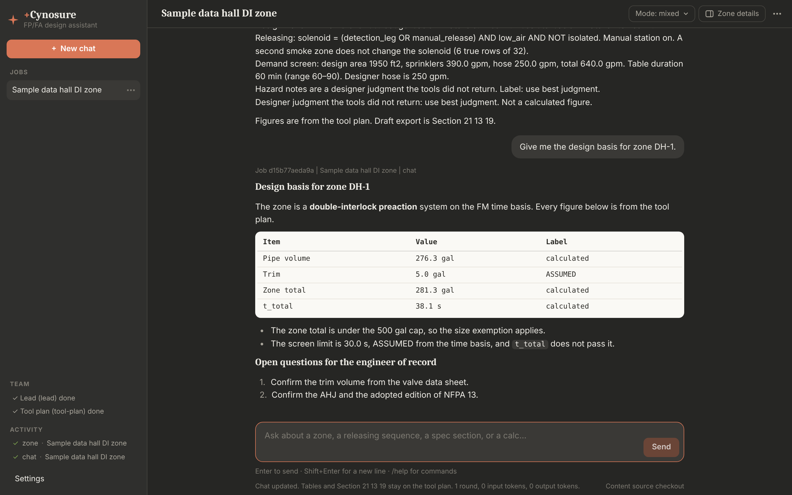

# +Cynosure

+Cynosure is a desktop design assistant for hyperscale data-center fire protection and fire alarm designers. It was called FP/FA Design Assistant until November 2026; the Python package, the data folder, and the environment variables keep the `fpfa` name, so an existing install keeps its jobs and its saved key.

Desktop prototype for hyperscale data-center fire protection and fire alarm designers. The scope is wet pipe, dry pipe, and double-interlock preaction sprinklers, plus the detection and releasing that trip them, and outdoor oil-filled transformer apparatus water spray (NFPA 15-style) in `skills/power-block-transformer-water-spray/SKILL.md`. Foam, clean agent, water mist, a building deluge system, and single-interlock preaction are out of scope. Canada ships only through a Country gate (US | Canada) on the skill. CAN/ULC-S524, S536, S537, S1001, and CEC Section 32 stay NEEDS HOLD. Apparatus water spray is not water mist and it is not a building deluge system.



The same window in the Linen scheme with the Zone details drawer open, and the Appearance panel of Settings, are in `docs/screenshots/`, beside a picture of the old tkinter window from before the restyle.

The v0 agent-team prototype plan, its decisions, and its acceptance tests are in `docs/prototype-plan.md`. The known answer for the sample zone is `docs/known-answer-dh1.md`. Coding agents start from `CLAUDE.md`.

The app reads methods from `skills/`, calculations from `calcs/`, and optional draft language from `specs/`. It does not hardcode those methods. Point it at another folder with the same layout (`FPFA_CONTENT_ROOT`, or Settings). Settings can also check the release feed and install a newer pack. `corpus/` holds edition pins and decision notes. The everyday path searches them with `search_corpus`.

## Why this stack

Python, because the calc kernel that already exists is Python and the other design apps in this practice are Python. Numbers are computed in `calcs/` and exposed to Claude as tools.

The window is a web page in a native window, built the way Spec Surgeon builds its window. The Python engine is unchanged: `app/fpfa/desk.py` holds everything the window knows and does (the jobs, the form, the thread, the inbox, the exports, the slash commands, which project a result lands on), with no window toolkit. A small local server (`app/fpfa/web/server.py`, standard library only) serves the page and an API over it on `127.0.0.1`, and pywebview shows the page in Microsoft Edge WebView2 (`app/fpfa/web/shell.py`), the same engine as Edge, which Windows 10 and 11 carry. The page (`app/frontend`, React and TypeScript, built with Vite into `app/fpfa/web/static` and committed) only draws what the app's state says and posts what the designer does. Nothing leaves the machine but the model calls the designer asks for and the content-pack update check.

Until November 2026 the window was the standard-library `tkinter` toolkit. It was slow: tkinter lays a long thread out on the CPU in Python, a resize reflowed the whole conversation, and the rounded look was made of generated pictures. Measured under Linux on one machine with a 60-turn thread, a resize took 191 ms there against 28 ms in the page, and opening Zone details 876 ms against 48 ms; a long job opens in about a tenth of a second, and the page lays out a turn only once it scrolls near the screen. AHJ Atlas's stack (Electron with a Node backend) was the other model in the practice; it would put a second runtime beside a Python engine, so it was not taken. `docs/prototype-plan.md` records the decision.

The server answers only on `127.0.0.1`, only to the page it launched: every API request carries a random launch token, a request whose Host is not that loopback address or whose Origin is another site is refused, and a request body is capped. Work that takes time (a narrated zone run, a chat turn, a blind check) runs on the inbox's workers. Their results go onto a queue that one pump thread runs about thirty times a second under the desk's lock, so the rules run one at a time exactly as they did on the old window's main thread. The page hears every change on one event stream (`/api/events`): the state when it changes, the conversation only when the conversation changed, and the words of a reply that is arriving, sent as they come and never more than about thirty times a second.

The look is the practice's: the five colour schemes of Build-a-Spec and Spec Surgeon, colour for colour, as CSS tokens (`app/frontend/src/styles.css`), with the same values listed in `app/fpfa/theme.py` for the title bar and the window's first paint; a test keeps the two equal. The page uses only React; it fetches nothing from the network and needs no web font. `app/fpfa/shapes.py` still draws the app icon in pure Python.

The model is Claude Opus 5.5, model id `claude-opus-5-5`, called with the Anthropic Messages API and each user's own API key. That id is the one published on the Claude platform models page for Claude Opus 5.5. The client does not send `temperature`, `top_p`, or `top_k`. It does not disable adaptive thinking, and it does not force `tool_choice` (this model rejects a forced tool). Every request marks the system text as a prompt-cache breakpoint, and a request that carries tools asks for automatic caching on the message tail, so the rounds of one turn and the turns of one session read the shared prefix from the cache instead of paying full price for it each time.

A typed question is streamed. The window calls `messages.stream` instead of `messages.create`, with the same request: the same model, the same cached system block, the same cache marker on the message tail, the same tools, the same three-attempt retry for a rate limit or an overload, and the same refusal to resend a request the API called too large. What comes back is the same message, so the tool loop, the record, and the usage totals do not know the difference. What changes is what the designer sees: the reply is drawn in the thread as it is written (see "How a reply arrives"). Tool definitions are not marked for eager input streaming. Every tool here takes a few scalars, the API keeps validating them, and the tool list stays byte-identical to the unstreamed call, so both read one cache entry. The zone narrative, the explosion-control starter, the blind claim check, and a specialist's or the checker's turn inside a chat turn are not drawn as they stream: the first two can be rejected in favor of the tool-plan text, and the others are not the reply.

The everyday path is how a typed question is answered. It loads the shell from `roles/everyday/ROLE.md` and lists the other specialist roles in `roles/<slug>/ROLE.md`, including the QA specialist. The model reads a specialist with `read_role` and a method with `read_skill` (`skills/<slug>/SKILL.md`). The Mode menu points at `modes/<slug>/MODE.md` the same way: brainstorm, calculator, synthesis, and mixed. The active mode file is the behavior for that reply. The model reads another mode with `read_mode`. Those files stay in the content pack. Calc tools still run in `calcs/` through the same tool loop. `fa_calc` runs `calcs/fa/lib`. `search_corpus` searches `corpus/`. The fixed tool plan in `app/fpfa/workflow.py` still fills the tables and the docx when a narrative disagrees. This path does not add another model vendor, and it does not send the skills to a hosted container runtime.

Spec files are loaded in full. Every `specs/*.md` file except the README is appended to the system text, sorted by file name, with its complete text. That system text goes on the everyday chat, the zone narrative, and the explosion-control starter. The app sets no file-count cap and no character cap on these files, and it does not summarize, skip, or shorten one. Earlier builds stopped after 12 files and cut each file at 16,000 characters, which dropped the end of Section 28 31 00 (all of §3.8, §3.9, and the closing paragraph). The eight files in this tree total about 50,500 characters, about 9,800 more than the old cap sent.

Loading specs in full increases token use, cost, and context use on every one of those requests. The tool loop sends the same system text on each tool round of a turn (up to 16 rounds). That text goes out as one block with a prompt-cache breakpoint, so the first round of a turn writes the tool list and the system text to the cache at the cache-write rate, and the later rounds, and later turns inside the cache lifetime, read them at the cache-read rate. A request that carries tools also asks for automatic caching on the message tail, so a skill body or a tool result read on one round is cached for the rounds after it. A mode switch or an installed content pack changes the system text and starts a new cache entry. The blind claim check is one call with no tools, so it gets the system marker and no tail marker. A larger `specs/` folder in a content pack still raises the size of every request and the cost of the first round of each turn. The status line after a chat turn, a zone run, or a starter that called Claude shows the rounds, the input tokens, the share read from the cache, and the output tokens, so a cache that stops hitting is visible. The model's context window and the API request size limit still apply to the whole request; loading in full does not make the context unlimited. When the API rejects a request as too large (HTTP 413, or a 400 that says the prompt is too long), the reply or warning says so in plain words and includes the API's message. The app does not trim the request, drop a section, or resend a shorter copy, and the files in `specs/` are not changed. A too-large rejection is not retried. Rate limits and overloads are still retried with the same full request.

`max_tokens` (16000 on these paths) caps what Claude writes in one response. It is an output setting and is not a limit on the spec files. A reply the API reports as unfinished starts with an "Incomplete reply" line in the chat thread that names the `stop_reason` (`max_tokens`, `model_context_window_exceeded`, `refusal`, `pause_turn`, or `tool_use` when the tool-round limit ran out). On a zone run or a starter, the same line is listed under Warnings and Flags. A zone run's flags go into the Section 21 13 19 export, so the line is there too. The tables and figures stay on the tool plan either way. The blind claim check and the `/heavy` hosted path do not receive the spec files.

`/heavy` is the escape hatch for a heavy job. It is the only path that opens a Claude Managed Agents cloud session (a hosted container). That path is text-only reasoning on the already-computed zone packet in the message. The container is not given `skills/`, `roles/`, `modes/`, or `calcs/`, and it has no network to fetch them. The prompt does not tell the model to call `read_role`, `read_skill`, `read_mode`, or a calc tool. Those tools stay on the desktop Messages path. The model id on the session stays `claude-opus-5-5`. The reply is written back into the same project thread and labeled with the job. The hosted session is not a second conversation. Ordinary chat, Sample DI, Sample BESS, and a zone tool plan do not use it. The session is deleted when the job finishes. A failed delete is written to the `fpfa.managed` log and named on the reply. A delete that is still on the network stays tracked until that attempt finishes. Closing the window, and process exit, delete a session that is still polling or still being deleted. That sweep waits about a second so a slow network does not hold the window. The cached agent and cloud environment are reused for later heavy jobs in the same process. They are not deleted with the session.

Deterministic math is never left to the model. The double-interlock screen runs a fixed tool plan on the form. Claude may call the same tools and write the narrative. If that narrative does not quote the tool-plan volume and delivery time, the export keeps the tool-plan narrative and the tables. The rejected model draft is not written beside them. A delivery time from these tools is an optimistic screen. It is not a listed water-delivery-time calculation.

## Run from source (Windows)

Install Python 3.11 or newer (3.12 is what this prototype was exercised with), then:

```bat
cd app
py -m pip install -r requirements.txt
py -m pip install pywin32
py -m fpfa
```

`requirements.txt` includes pywebview, which brings pythonnet on Windows; the window is WebView2. The built page is committed in `app/fpfa/web/static`, so a source run needs no Node.js. `py -m fpfa --theme linen` opens the window in one of the colour schemes for that run (`clay`, `blueprint`, `graphite`, `carbon`, `linen`). Settings saves the lasting choice. `py -m fpfa --browser` opens the page in the default browser instead of the app's window, and does so by itself when pywebview has no window backend on the computer (WebView2 missing, or Linux without GTK or Qt); the server then runs until Ctrl+C in the terminal. In the browser the Save dialog is the one thing missing, so an export is written to `Documents\Cynosure exports` (or the data directory) under its suggested name, never over an existing file, and the status line names the path. `py -m fpfa --serve --port 47011` serves the page and prints its address without opening anything.

To change the page, install Node.js 22 and, from `app/frontend`, run `npm ci` once, then `npm run build`, which type-checks the page and writes `app/fpfa/web/static`; commit that folder with the change. `npm run dev` serves the page with hot reload on port 5173 and sends `/api` to an app started with `--serve --port 47011` (`CYNOSURE_API` names another address); open the address `--serve` prints with the port changed to 5173. `npm test` runs the page's own tests.

`pywin32` lets the `keyring` package store the API key in Windows Credential Manager. If Credential Manager is unavailable, the app stores the key in a user-only file under `%APPDATA%\fpfa-assistant`. Settings and the status line say which store holds the key. The key is not written into the project file, the chat log, or the exported document. A source run reaches `keyring` through a short-lived child Python process (`py -c ...`), so a keyring that never answers times out instead of hanging the window. The window reads the key once at launch and keeps it, so a click never waits on that process; saving or clearing the key in Settings reads it again, and while no key is kept the store is asked again each time one is needed.

On Linux or macOS the same commands work with `python3` in place of `py`. The key is stored in a user-only file under `~/.local/share/fpfa-assistant` (or `$XDG_DATA_HOME`), mode `0600` where the filesystem allows it. Set `FPFA_USE_KEYRING=1` before starting the app to use the system keyring instead. A missing keyring on those desktops can open a blocking password dialog, so the file is the default there.

Projects are JSON files in that data directory. Override it with `FPFA_DATA_DIR` if you want them somewhere else.

## Content updates

Settings shows the content version, **Check for updates**, and a short changelog. The check reads a manifest, downloads a newer zip, verifies sha256, and then points the saved content folder at the new tree. Until that pointer moves, the app keeps the last good pack. If the saved folder is missing or incomplete, the app uses the bundled seed: this checkout when you run from source, or the seed folder shipped with a packaged app.

The API key and the project files live in the data directory. A content update leaves them there.

The default feed is the `manifest.json` asset on the latest GitHub Release:

`https://github.com/Abe-Borg/fp-fa-content/releases/latest/download/manifest.json`

A static URL that serves the same JSON works for a mirror or a test. The feed can also be the GitHub API document for the latest release (`https://api.github.com/repos/Abe-Borg/fp-fa-content/releases/latest`). The app then downloads the `manifest.json` asset named in that document. The manifest lists `version`, `created`, `sha256`, `filename`, and `changelog`. `min_app_version` is optional.

`FPFA_CONTENT_FEED_URL` overrides the feed for this process. `FPFA_CONTENT_ROOT` pins the content folder, and a check leaves that folder in place. `FPFA_CONTENT_UPDATES=0` skips the launch check. A packaged app checks on launch. A source checkout checks on launch after a feed has been saved, or when the feed override is set. Offline, the window still opens and the last good pack stays in place.

Installed packs live under `content-packs/` in the data directory. The app keeps the current pack and one previous pack. The everyday path searches `corpus/` with `search_corpus`. The pack still carries that folder.

## Release pack

Build the zip and manifest from this checkout:

```bash
python3 scripts/build_content_pack.py --version 2026.10.1 --out dist --changelog "Short note"
```

The zip includes `skills/`, `calcs/`, `corpus/`, `specs/`, `modes/`, and `roles/`, plus `pack.json`. The build omits `app/`, project files, API keys, `__pycache__`, `_sources`, and path names for foam, clean agent, Canada, and vendor catalogs. Scope-lock sentences that name those systems as out of scope stay in the skill files. The manifest sha256 is the zip file.

Pushing a tag `content-v2026.10.1` runs `.github/workflows/content-pack.yml`, which publishes `manifest.json` and the zip as Release assets. The tag message becomes the changelog when it has text. A chat command that opens a curation pull request is not wired.

## Packaging

From `app/` on the machine that should run the app:

```bat
py -m pip install -r requirements.txt pyinstaller
py packaging\build_app.py
```

On Linux or macOS, use `python3` in place of `py`. PyInstaller builds for the OS it is running on, so a Windows `.exe` comes from a Windows run (`app\dist\Cynosure\Cynosure.exe`, or `packaging\build_app.ps1`). A Linux run writes `app/dist/Cynosure/Cynosure`. The folder includes a seed content pack, and the packaged app checks the release feed on launch. Smoke that Linux binary with `FPFA_CONTENT_UPDATES=0 ./dist/Cynosure/Cynosure --demo --quit` from `app/`. That runs the seed pack and the sample tool plan. It does not produce `Cynosure.exe`. `python3 packaging/build_app.py --seed-only` writes the seed folder and stops before PyInstaller. On Windows, `packaging\build_app.ps1` then `packaging\build_installer.ps1` writes `app\dist\Cynosure-Setup-<version>.exe` (Inno Setup 6). Pushing a tag `app-v*` (for example `app-v0.1.1`) runs `.github/workflows/windows-app.yml`, which publishes that setup exe and `Cynosure-windows-<version>.zip`. The tag's version must equal `__version__` in `app/fpfa/__init__.py`. The same workflow can be run by hand from the Actions tab: leave `version` empty to read it from the code, and turn `publish` off to build without a release. In that mode the installer and the zip are uploaded as a workflow artifact named `Cynosure-windows-<version>-<sha>`, kept for 14 days, and nothing is tagged. That is how `docs/acceptance-tests.md` gets an installer from a branch. Content packs stay on `content-v*` tags.

The build puts the license terms in the folder. After PyInstaller finishes, `build_app.py` copies the repository's `LICENSE` into the folder as `LICENSE.txt` and writes `THIRD-PARTY-NOTICES.txt` beside it, so the installer and the portable zip both carry them (see "License"). A bundled package with no license text fails the build. `python3 packaging/third_party_notices.py --check` runs that check on its own, before the long build; the Windows workflow does. `--skip-notices` leaves the notices out for a local trial, and a folder built that way must not be distributed. The exe, the installer, and the shortcuts carry the app icon, `app/packaging/assets/Cynosure.ico`: the four-point star from the window on a rounded square. `python3 packaging/make_icon.py` redraws it. The build also copies the package metadata of `anthropic`, `python-docx`, and `pywebview` (and `pywin32-ctypes` and `pythonnet` on Windows) into the bundle, so **About and versions** in a packaged app reports their versions instead of "not installed".

The window goes into the bundle too. `build_app.py` adds the built page (`app/fpfa/web/static`) as data and refuses to build when it is missing, collects pywebview whole together with pythonnet and clr_loader on Windows (pywebview picks its WebView2 backend at run time, where PyInstaller cannot see it, the way Spec Surgeon's spec collects it), and excludes tkinter, so no Tcl or Tk ships. The Microsoft Edge WebView2 runtime is not bundled: Windows 10 and 11 carry it and keep it updated. On a machine without it the packaged app opens its page in the default browser instead. The build machine needs no Node.js, because the page is committed already built.

The installer upgrades an install made under the old name in place. Its AppId is unchanged, so Setup finds the earlier install, removes `fpfa.exe` and the "FPFA App" shortcuts, and leaves `Cynosure.exe` and a "+Cynosure" shortcut. A new install goes to a `Cynosure` folder. The data folder (`%APPDATA%\fpfa-assistant`) is not touched either way.

The packaged app cannot start a child Python for `keyring`, because there `sys.executable` is `Cynosure.exe`. Relaunching it only re-opened the app, which rejected the `-c` argument, so every save fell back to the user-only file. A frozen build therefore calls `keyring` inside its own process on one worker thread with the same timeout (8 s on Windows). That thread runs calls in the order they were made. A call that timed out still runs before any later call, so a slow delete cannot remove a key saved after it. If Credential Manager does not answer, the key still lands in the user-only file and the status line says so. `packaging/build_app.py` copies keyring's package metadata (its backends are found through entry points), collects `keyring.backends`, and on Windows adds `keyring.backends.Windows` and `pywin32-ctypes` (`win32ctypes`), keyring's own Credential Manager dependency. PyInstaller 6 hooks already collect these. The explicit flags guard against a hook change. The packaged app does not need a separate `pywin32` install. Credential Manager storage from the packaged `Cynosure.exe` still has to be confirmed on a real Windows machine: save a key in Settings, check that the status line names Windows Credential Manager, and look for `fpfa-assistant` under Control Panel > Credential Manager > Windows Credentials.

## Conversation-first window

The chat thread is where work happens. Open the app, type a question, press Enter. You do not have to fill in a form or run a sample first.

The window has three parts:

- **Sidebar (left).** The +Cynosure wordmark and star, **+ New chat**, your jobs under it, and **Settings** at the bottom. A new chat takes its name from your first question (for example "How should I split a 40,000 ft2 data hall into…"); a name too long for the sidebar is cut with an ellipsis, and the open job has a rounded highlight. Right-click a job, or use the ⋯ that shows on the job's row, to rename or delete it; with a job focused, F2 renames it, Delete deletes it, and the arrow keys move between jobs. Deleting asks first. Deleting the open job clears the thread. **Activity** appears above Settings once a job has run. It lists zone runs, chat turns, claim checks, and heavy jobs, each with a mark for its status (○ queued, ● running in the accent colour, ✓ done, ! error or interrupted, ✕ cancelled), its kind, and its job name.
- **Thread (middle).** Your messages and the replies, in one readable column that stays centered. A message you typed is a rounded bubble on the right; right-click it to copy it. A reply is plain text on the window colour, rendered from markdown: headings in the serif display face, bullets, numbered lists, **bold**, `code`, and fenced code and tables on a paper-coloured block, tables as real columns in the monospace font with a ruled header. Every line of a reply stays a line, so figures the model puts on consecutive lines read that way. Single asterisks and underscores are left alone, so names such as `t_total` stay intact. Each reply starts with a small caption naming its job (`Job <id> | <project> | <kind> | <title>`; a chat reply's caption stops at the kind, because the question is right above it). While a job for this project is queued or running, the last line of the thread is three pulsing dots, "Working on it…", and a few words on what the app is doing. Right-click the thread for Copy, Select all, and Copy the whole conversation (your messages included); with the thread focused, Ctrl+A selects it and Ctrl+C copies. Typing while the thread has the focus goes to the composer.
- **Top bar.** The job name, **Mode** (brainstorm, calculator, synthesis, mixed), the **Zone details** toggle, and the **⋯** menu. The menus are drawn by the page in the window's colours.

The window works from the keyboard as well as the pointer. Tab and Shift+Tab move between the controls, and the control they reach wears a ring in the accent colour (on an accent-coloured button, drawn inside it in the colour of its text). The ring is for the keyboard only (the page's `:focus-visible`): a click gives a control the focus without it, so no ring is left on the last button you clicked. With **Mode** or **⋯** focused, Space or Enter opens its menu with the first row already chosen, and Down opens it too. In a menu, Up and Down move over the rows that can be chosen (a greyed row is passed over), Home and End go to the first and the last, Enter or Space chooses, and Esc or Tab closes it without choosing. Closing a menu puts the keys back on the button that opened it. In the composer Tab leaves the box, as in any web form. The Zone details tabs move with the Left and Right arrows. A dialog keeps the focus while it is open, Tab stays inside it, and Esc closes it.

The composer is multi-line, in a rounded card whose edge takes the accent colour while you type. Enter sends, Shift+Enter adds a line, and the box grows as you type, from two lines to eight. The cursor starts there when the window opens. Ctrl+S saves the open job, Ctrl+N starts a new chat, and closing the window saves too.

Above the composer there can be one-tap suggestions. On an empty thread they are **Load the sample zone**, **Show the commands**, and, once a key is saved, a starter question. After a zone has run and before you have typed a question, they are **Design basis**, **Explain the screen**, and **Questions for the engineer**, each a question about that zone. A suggestion sends exactly the message it stands for, as if you had typed it, so the slash commands and the questions go down the paths they always did. Typing a question of your own, or a job in flight, clears them. The app writes these suggestions; the model does not.

While a job on the open project is queued or running, **Stop** appears under the composer. It is the same cancel as **Cancel running job** on the Team tab: the turn stops before its next model round, and a round or a tool already in flight finishes.

An empty thread shows a short welcome. Two links sit under it. When no API key is saved, one link opens Settings. The other loads the sample double-interlock zone. The sample is optional and never required before a question.

The **⋯** menu holds everything else: Sample DI zone, Sample BESS room, Run zone from Zone details, Export draft Section 21 13 19, Export Design Basis and Open Questions, Team panel, Usage and cost, Narrate zone runs with Claude (on by default once a key is saved), Rename job, Settings, Commands, and About and versions. On launch the only plain buttons besides the top bar are New chat, Settings, and Send.

Rename, delete, and every message the app shows (an export that needs a run first, a value that is not a number) are dialogs in the window's own colours rather than grey system boxes. The file-save dialog is still the system's: the Windows Save dialog, which opens on a thread of its own so the window keeps drawing while it is up.

**Zone details** is a drawer on the right, closed until you open it (the toggle in the top bar, or the ✕ in the drawer's corner to close). It has the Basis, Zone, and Results tabs (pipe segments, time basis, trim, and the rest of the zone inputs), plus a **Run zone** button that posts the run into the thread like `/run`. The form scrolls on a short screen. It keeps its values when the drawer is closed. What you type reaches the app a quarter of a second after you stop, and every action (send, run, switch jobs, save) waits for the last of it first, so a run always uses the form as it is on screen. A segment is added from the row under the table (Enter in its fields adds it too; the pipe ID comes from the calc pack) and removed with the ✕ on its row. The Results tab shows the tool-plan figures on a paper-coloured sheet, because they are what goes into the exported document.

WebView2 draws the page at the display's scale, so text is sharp at 125%, 150%, and 200%. Fonts are Segoe UI for text, Georgia for the wordmark and headings, and Cascadia Code or Consolas for code and tables, with a fallback on other systems. The window opens maximized. The title bar takes the scheme's colours on Windows 11 and switches between dark and light on Windows 10 (1809 and later), when the window first shows and whenever the scheme changes; an older build keeps its own title bar.

### Appearance

Settings, **Appearance**, has the five colour schemes of the practice's other apps, colour for colour: **Warm Clay** (the default: warm charcoal, cream paper, terracotta), **Blueprint** (deep navy, drafting blue), **Graphite & Teal**, **Carbon & Hi-Vis** (true black, safety orange), and **Linen** (the one light scheme). Each card previews its scheme in that scheme's own colours. A click recolours the window at once and saves the choice in `config.json` in the data directory, so it is the scheme the next launch opens in; the window's background before the page paints is that scheme's too, so a light scheme never opens on a dark frame. Tab stops at each card, and Space or Enter picks the focused one. The card in use has an accent edge; a hover changes only the edge, so the card's text never sits on a mismatched patch. `FPFA_THEME=<id>` or `--theme <id>` overrides it for one run. In every scheme the text reads at 7:1 or better on the window, the sidebar, and a card, secondary text at 4.5:1, and the document-like surfaces (the Results sheet, code and table blocks, the license) stay near-white paper with dark text.

**Reduce motion** on the same panel shows each reply at once, with no easing, no pulsing dots, and no shimmer. `FPFA_REDUCE_MOTION=1` does the same for one run, and so does the reduce-motion setting of Windows itself.

### How a reply arrives

A reply does not appear all at once after a silent wait. While the model works, the working line under the thread says what the app is doing in a few words: thinking, reading a named skill, role, or mode, searching the corpus, running a named calc tool, reading or writing the project record, handing off to a named specialist (and then that specialist's own steps, prefixed with its slug), or running the blind check. The line names the tool or the file. It never shows a tool's inputs or its result, so no figure is on screen before the reply states it with its label.

When the lead starts writing, its words are drawn in the thread as they arrive, under the job's caption, with a caret after the last word. They come onto the screen at a reading pace instead of in network bursts, and the newest words fade in from the window colour. Bold and code are drawn as they will end up while they are still half written, so nothing jumps. A reply is drawn block by block, split at its blank lines: a block that has settled is drawn once and never again, and only the one still growing is drawn each frame, so a long reply stays cheap to draw. If you scroll up to read, the thread stays where you put it until you scroll back to the end, and a **Latest** button below the thread brings you back. That holds however you scroll: the wheel anywhere over the thread, the scrollbar (a press in its trough moves the thread before any release), and Page Up, Home, and the arrow keys. While you are at the end the thread stays there: whatever makes it taller (a new turn, a word, a table taking its width) keeps the last line in view. A specialist's and the checker's words are never drawn in the thread: they are record rows and a Team block, as before. If the lead writes a line before it calls a tool and then writes its answer in a later round, the later text replaces the earlier, because the reply that is saved is the text of the last round that wrote any. If a streamed attempt fails and is sent again, the words of the failed attempt are removed before the new ones arrive.

When the turn ends, the reply is saved on the job exactly as before, with its caption and its Team block, and the thread carries on from the words already on screen instead of redrawing them. A reply that arrives whole (a zone run's tool-plan narrative, a slash command, a claim check, an error) eases in the same way: 800 characters take about a second. Opening a saved job draws its thread at once. The pacing rules are the ones Spec Surgeon uses (`app/frontend/src/reveal.ts`, a copy of its rules).

- **Sample DI** (the welcome link, ⋯ → Sample DI zone, or `/sample-di`) creates the sample data-hall double-interlock job and runs the existing zone tool plan. It opens its own job. It does not write over the thread you were in. That path does not need an API key. The reply starts with a line that says what was loaded ("Sample loaded: data-hall double-interlock zone DH-1 (4 pipe segments, FM time basis). This is sample data, not a real building…"), then the narrative, including the ASSUMED trim line and the ASSUMED screen limit. The zone inputs are filled in under Zone details, and the same figures stay on the Results tab for export. Follow-up questions in that thread use those figures.
- **Sample BESS** (⋯ → Sample BESS room, or `/sample-bess`) creates a generic Li-ion BESS room and runs the explosion-control starter in synthesis mode. Its reply also starts with a "Sample loaded" line. That path does not need an API key. The method stays in `skills/ess-isolation-venting-and-duration/SKILL.md`. Mixture LFL and setpoints come from the LFL tool. An election or a duration the tool did not return is labeled ASSUMED. The sample room has no sprinkler zone, so the draft does not invent gallons or seconds. If that project already has a zone tool plan, the starter quotes it and those gallons and seconds govern when the narrative disagrees. Export of Section 21 13 19 still needs a zone run.
- `/run` (or **Run zone** in Zone details) runs whatever is on the zone form.
- `/new Job name` starts a named job. `/help` lists the composer commands.
- **Export draft Section 21 13 19** (in the ⋯ menu) still needs a finished zone run. Before the file is written, the app runs the blind claim check from `skills/blind-claim-check/SKILL.md`. The QA checker is `roles/qa-specialist/ROLE.md`. That turn receives only the claim list and the short cites. It does not receive the draft, the spec section, or the designer's notes. Claims come from the narrative the export writes, including a figure with no section and a sentence that names a section a tool already named. A tool string may be shown as a package assertion. It is not a passage from the standard, and copying it back as the cite does not support the claim. Export waits until every such claim is Supported. That result does not mean the narrative was compared to the standard. Engineer-of-record review still applies. A cite marked `NOT PULLED` stays open. The check is a `claim` job on the inbox, labeled `Job <id> | <project> | claim | <title>`, and the result is posted into the same project thread. It does not open a hosted container. The draft section stays 21 13 19.
- A normal message, with a key saved, uses the everyday path and includes the earlier turns in that project. The window does not wait on the call. The question is saved on the job right away, and the reply is written into the thread when it arrives. The path can read a specialist role, a mode, and a skill, and it can call the calc tools. The Mode menu (or `/mode`) chooses brainstorm, calculator, synthesis, or mixed. If a tool plan has already run, the request repeats those governing figures. The chat reply does not replace the tables or the export. **Narrate zone runs with Claude** in the ⋯ menu decides whether `/sample-di`, `/sample-bess`, and `/run` also ask Claude for the narrative. Numbers in the tables and the export stay on the tool plan either way.
- The inbox (Activity, in the sidebar) is the queue of zone runs, chat turns, an explosion-control starter that calls Claude, a blind claim check, and a heavy job. Two workers run the long jobs. The composer stays usable while a job runs, including a second message and a switch to another project. A result that finishes later is labeled with its job id, project name, and kind, and it is written onto the project that started it. A local tool plan with no model call still finishes before `/sample-di`, `/sample-bess`, or `/run` returns, and it is recorded on the same inbox.
- `/heavy task` sends that task through the hosted runtime and posts the reply into the same thread. The turn is text-only reasoning on the zone packet already in the message. It does not call `read_role`, `read_skill`, `read_mode`, or a calc tool, and it does not recompute zone gallons or seconds. It does not open another project. A typed question, `/sample-di`, `/sample-bess`, and `/run` stay on the path they already had.
- Jobs are JSON files in the data directory. A first `/run`, `/help`, or chat message keeps whatever is already on the zone form. The sample zone is generic. It is not a constructed building.

Settings has four panels. **Appearance** has the colour schemes and Reduce motion (above). **Anthropic API key** has the key field, Save key, Check key, and Clear key, and says which store holds the key. **Content pack** shows the content version, Check for updates, and What's new; the content feed URL and the content pack folder are under **Advanced**. **About +Cynosure** has the version, the copyright line, the license in brief, and three buttons: **License** (the terms this copy ships with), **Third-party notices**, and **About and versions**.

Blank trim (5 gal) and the screen-limit seconds are labeled ASSUMED on the Zone details form, in the thread after a run, on the Results tab, and in the export. Pipe gallons and trip time are calculated. A value the designer types is not assumed. A designer judgment the tools did not return is labeled use best judgment. That label is not ASSUMED and it is not a calculated figure. A delivery time from these tools is an optimistic screen. It is not a listed water-delivery-time calculation.

Check key in Settings calls the models endpoint for `claude-opus-5-5` and does not generate text.

## Project record

Every job has rows in one SQLite database, `fpfa.db` in the data directory. The record is the durable store the agent-team prototype builds on (`docs/prototype-plan.md`, Phase 1). It holds facts (basis of design and assumptions, each with a label), evidence (cites with edition, section, a short paraphrase, and a status of held, NOT PULLED, NEEDS HOLD, or PACKAGE ASSERTION), calculation records, findings, open questions, decisions, handoffs, tasks, agents, and an append-only event log. Documents are exports of the record. Nothing in the record is edited by hand.

Calc tools record themselves. When a zone run, a starter, or a chat turn calls `zone_trapped_volume`, `dry_delivery_screen`, `di_trip_to_water`, `density_area`, `hose_duration`, `nitrogen_gate`, `elect_di_trim`, `releasing_truth_table`, `resolve_pipe_id`, `lfl_setpoints`, `fp_calc`, or `fa_calc` on a job, the tool, its inputs, its output, the content version, the identity of the calc code, and the caller (`tool-plan`, `narrator`, `lead`, or a specialist slug) are written as one calculation record. The record is keyed by a hash of the tool, the inputs, and the calc identity, which is a hash of the kernel files under `calcs/fp` and `calcs/fa/lib` in the running pack. A second call with the same inputs on the same job from the same calc code returns the recorded output and counts a replay instead of writing a second row. That is the duplicate prevention the recovery phase relies on. A content-pack update that changes a kernel file changes the identity, so the next call computes fresh and writes a new row; the old row stays as history with its pack version and calc identity, and the Design Basis export prints both beside each record's inputs. A result returned to a model context carries `record_id`, the id of its calc record, so a finding can cite it in `supports`; the fixed tool plan gets the bare output, so its tables and export are byte-identical to a run with no record. A tool session that has no record attached, which is how the calc tests and the form's pipe-ID lookups run, writes nothing and behaves as before.

Five record tools are on the everyday path beside the calc tools: `record_fact`, `record_evidence`, `record_finding`, `open_question`, and `record_decision`. `read_record` shows the job's record with row ids: each calculation record with its inputs and its scalar outputs, each evidence row with its document, edition, section, note, and status, and the findings, decisions, open questions, and pending handoffs. `read_record` with `kind` returns the full rows of one table, and with `kind` and `id` returns one row, so a later turn can pick the right calc record or cite by its contents. A fact, finding, or decision carries exactly one label: calculated, ASSUMED, use best judgment, or a cite class (CODE, OWNER, PRACTICE, PARA, HB). A row with no label, or an evidence row with an unknown status, is refused and the model sees the refusal as a tool error. Rows written by the model carry the agent name of the context that wrote them.

Opening a job imports it into the record once: the basis fields become facts (editions as CODE, the insurer as OWNER, the AHJ and hazard notes as use best judgment) and the tool calls in a saved zone run or starter become calculation records. After that, the five form-owned basis fields follow the form: on every open, save, run, and chat turn the record compares them to the current basis rows and, where a value changed, writes a new row and marks the old one superseded. The current rows are what `read_record`, the specialist briefs, and the export show; the superseded rows stay as history. Deleting a job deletes its record rows. The record does not change the chat thread, the zone form, the tables, or the Section 21 13 19 export.

## Design Basis and Open Questions export

**Export Design Basis and Open Questions** in the ⋯ menu writes a second Word document from the job's project record (`app/fpfa/design_basis_docx.py`). Every line is read from the record; nothing is typed by hand and nothing from the chat thread is copied in. The sections are: basis of design, with the cites held on the record; elections, read from the trim, releasing, and nitrogen calc records and from recorded decisions; calculation records, one row per record with the caller, the time, the replay count, the key figures with their labels, and the inputs as passed; findings grouped by contributor with the ids they rest on; checker verdicts, or a line saying no blind claim check has run on this record; assumptions, every ASSUMED row and every ASSUMED flag a calc returned; open questions and RFIs, with answered ones listed after; and the handoff log. The export needs a job with at least one recorded calculation, fact, or finding. It does not wait for the blind claim check in this phase; the checker that reads from the record arrives with the team in Phase 3, and the document says so when no check has run. The Section 21 13 19 export is unchanged and still waits for every claim to be Supported.

## The team

A chat turn on a job is the lead of a team (`app/fpfa/team.py`). The lead is the everyday path with three more tools. `list_specialists` names the specialist roles in the content pack: every `roles/<slug>/ROLE.md` except the everyday shell and the QA checker, so `fa-releasing`, `fp-sprinkler`, and `spec-draft` in this tree. `delegate(specialist, brief, inputs)` runs that specialist in its own context: its `ROLE.md` is the system text, with the skill index and a paragraph that says how to record its work (`spec-draft` also gets the spec files, the others do not). The specialist has the calc tools, the content tools, the record tools, and `handoff`, but not `delegate`, so it cannot delegate in turn. Its user message is the brief, the lead's inputs, its own earlier contribution on the job, any handoffs waiting for it, and the record summary with row ids. Everything it writes carries its slug. The lead gets back a contribution: the specialist's summary and the findings, questions, cites, handoffs, and calc record ids it wrote. The lead's handoff to the specialist is written to the record first and marked returned with the summary; a specialist that fails leaves it cancelled and the agent marked error.

`handoff(to, brief, payload)` writes a pending row for another agent. No specialist talks to another directly in this version. A handoff is delivered when the lead next delegates to the receiver, and it is marked returned when that delegation finishes. That is what makes every substantive exchange a row with a sender, a receiver, times, and content.

`request_check` runs the blind checker over the record's findings. Each finding is one claim. Its cite is built from the rows it names in `supports`: a calc record becomes a package assertion with that tool's figures, an evidence row becomes its document, edition, section, and note, and a finding with no supports, or one that rests on a NOT PULLED or NEEDS HOLD cite, is `NOT PULLED`. The checker is the same QA role and the same one-call blind turn as the Section 21 13 19 check; it sees only the claim list and the cites. A verdict is written onto each finding. A finding that rests on a calc record alone is Supported only if the package figures carry every number in the claim, as before. The outcome is logged on the record, and the Design Basis export now waits for it: a record with findings exports only after a check that is current (no finding added or changed since) supports every one. A record with no findings has nothing a checker could judge, so the tool-plan figures export on their own with the no-check line.

The lead's system text gains one paragraph on the team when a record is open. Usage is summed across the lead and every specialist it ran, and the status line after the turn shows the total. A chat without a record, which is how the tests drive the plain loop, has none of this.

### The Team tab

The right-hand drawer has a fourth tab, **Team** (`app/fpfa/team_panel.py` builds what it shows; the page draws it), reached from the ⋯ menu (**Team panel**), by clicking the TEAM roster in the sidebar, or by opening Zone details and choosing the tab. It is drawn from the project record and redrawn after every job. **TEAM** lists each agent with a glyph for its state (● working, ✓ done, ! error or interrupted, · idle), its role slug, and how many findings and questions it has written; the lead and the tool plan are agents too. **BLOCKERS AND OPEN QUESTIONS** lists open questions, handoffs still waiting for a receiver, findings the checker did not support, and the state of the last blind check. **HANDOFFS** is one row per exchange: time, from, to, status, and the brief. Selecting a row (a click, or Enter on a focused row) opens its brief, payload, and result in **DETAIL**. The same roster appears in the sidebar under JOBS once the job has an agent, and clicking it opens the tab. Specialist activity stays out of the thread; what the thread gets after a lead reply is a short app-written **Team** block naming each specialist that ran, what it recorded, and the checker's count, so the thread shows contributions rather than chatter.

Three buttons sit on the tab. **Cancel running job** sets a flag that the tool loop checks before each model round; the round in flight finishes, a tool already running finishes, and then the turn stops with a "Cancelled" line in the thread and a `cancelled` status in Activity. A specialist cancelled mid-delegation is marked interrupted and its handoff cancelled. A narrated zone run or `/sample-bess` starter that is cancelled keeps its tool plan: the figures and tables had already run, so they post as usual under a "Cancelled" line, the narrative falls back to the tool-plan template, the flags carry "Narration cancelled by the designer", and the job is marked `cancelled` rather than `error`. A blind check that is cancelled while it waits in the queue makes no model call and writes no verdicts. **Run blind check** runs the record-fed checker as a `claim` job without a chat turn and posts the verdicts into the thread; it needs findings on the record and a saved key, and says so otherwise. The check line on the tab speaks for the findings the check saw: when a finding is added or changed after the check, the line says the findings changed and a new check is required, which is the same rule the export gate applies. **Export basis…** is the same export as the menu item.

### Recovery after a relaunch

The inbox is in memory, so a job does not survive the app closing. What survives is the record. Every job the window runs is also a `jobs` row in the record, with its id, kind, title, status, error, and start and update times, written from the inbox refresh once per status change. A job never moves back there: a late `queued` after `running` is ignored and a finished job stays finished. On launch, before the window takes any work, `Record.recover()` runs once over every job in the database in one transaction. A job still `queued` or `running` is marked `interrupted`, an agent still `working` is marked `interrupted`, and a handoff still `delivered`, which means its receiver was mid-turn, goes back to `pending` with a note saying it was re-queued after a relaunch. The same rows are updated and nothing is copied, so no handoff is repeated and no calc record is duplicated. Finished rows are not touched and a second pass finds nothing.

What the designer sees: the status line counts the jobs interrupted and the handoffs re-queued; Activity lists each interrupted job under its original id with the status `interrupted`; opening the job posts one app-written note into its thread naming the interrupted jobs and agents and the re-queued handoffs, and the note is saved with the thread so it is posted once; the Team tab roster shows the interrupted agents with `!`, and the blockers pane lists the re-queued handoffs and the interrupted jobs. The note is owed until it is read: the recovery pass writes what it touched onto a `recovered` event, and until a `recovery_noted` event follows it on that job, every later launch shows the same status line, lists the same interrupted jobs in Activity, and posts the note when the job is first opened. Closing the app without opening the job loses nothing. Nothing is re-run on its own. The designer sends the question again or runs the zone again, and identical calc inputs replay from the record instead of recomputing, which the Design Basis export shows as a replay count. The lead's next turn starts with the handoffs waiting on the record, re-queued or not, so it can deliver each by delegating to its receiver; the specialist's brief then carries the handoff as before, and the same row moves to `delivered` and `returned`.

One window per data directory. The first window takes an operating-system file lock on `fpfa.lock` in the data directory (`app/fpfa/instance_lock.py`) before it reads the record, and holds it until it closes. A second window started on the same directory is refused with a message and exits, because its launch pass would treat the first window's running jobs as interrupted and re-queue handoffs that are still being worked. The lock belongs to the process: a kill releases it, so a crash never blocks the next launch, and a relaunch after a kill recovers as above.

Sleep and wake: the app's pump runs about thirty times a second and keeps the wall-clock time of its last tick. A gap longer than 90 seconds means the machine slept or the process was frozen. On the first tick after it, a `wake` event with the gap and the running job ids is written on the open job, and the status line says the app resumed and what to expect of a job that was running: it finishes, or it reports the connection error in its thread, or the designer cancels it from the Team tab. Nothing is restarted. `docs/recovery-protocol.md` is the protocol for acceptance tests C and D: what the automated tests prove, the manual Windows steps with the expected result of each, the known limits, and a results table.

### Usage and cost

Every model context writes what it spent onto the job's record, so the cost of a task can be read back after the fact. A lead turn closes with a `turn` event whose usage is the task total: the lead's own rounds plus every delegation and blind check it ran. A cancelled turn writes the same event with `cancelled` set and the usage of the rounds that did run, because they were billed; the lead is marked interrupted rather than error. A cancel that lands while a specialist is mid-turn ends the lead's turn at once: the specialist's finished rounds are written as a cancelled `delegation` event with their usage, and the lead's cancelled `turn` total includes them. Each delegation writes a `delegation` event with its own usage; it is already inside its turn's total. The report reads every usage event on the job, not a recent window, so a long job's total is complete. A narrated zone run or `/sample-bess` starter writes a `narration` event, cancelled or not. A blind check carries its usage on its `record_check` event. The tool plan alone writes nothing, because it costs nothing.

`/usage` in the composer, or **Usage and cost** in the ⋯ menu, posts a report into the thread: one line per model context with rounds, fresh input, cache write, cache read, and output tokens and its dollars; the job total; the estimated cost split by token class; and the share of input read from the cache. Delegations are listed under their turn and marked as not added. From a source checkout `python -m fpfa.usage_report` prints the same for one job or every job in a record database (`--db`, `--project`, `--json`), with the four rates overridable on the command line. The rates are a dated snapshot in `app/fpfa/usage_report.py` (`RATES_PER_MILLION`, `RATES_DATE`), the Claude Opus 5.5 list prices per million tokens on that date, and the report prints the rates and the date it used. It is an estimate from list prices, not a bill.

### About and versions

**About and versions** in the ⋯ menu (and in Settings) opens a box that scrolls and has a Copy button. It starts with the name, the copyright line, what the license allows in one sentence, and the notice that the output is a draft for the engineer of record. Then it lists the app version and whether it is frozen, the model id, the Python and OS versions, the installed versions of `anthropic`, `python-docx`, `keyring`, `pywin32-ctypes`, `pywebview`, `pythonnet`, and `pyinstaller`, the content pack version and folder, the data directory, and the record schema version. The page adds a last line, `Window`, naming the Edge engine version WebView2 runs (or the browser, in the browser fallback). `python -m fpfa --versions` prints the version lines and exits without opening a window. Acceptance test A copies them into its versions table.

### Acceptance tests

`docs/acceptance-tests.md` is the protocol for tests A through E from the plan of record: how to get an installer, what to do on the clean machine, what passes, and the result tables for versions, cost per task, and failures. Tests C and D keep their protocol in `docs/recovery-protocol.md`.

## License

+Cynosure is source-available under the [PolyForm Shield License 1.0.0](LICENSE).

The app is Abraham Borg's own: he holds the copyright, and the installer names him as the publisher (the name Windows shows beside the app under Installed apps and in the setup file's properties).

**In short:** use it for anything, including commercial work, except to provide a product that competes with +Cynosure. A design firm running it on billable projects is squarely permitted. Reading, forking, modifying, and redistributing it are permitted. Selling a rival design assistant built on it is not, unless you hold a separate license from the copyright holder. The [LICENSE](LICENSE) file governs; this paragraph is a summary, not the terms. This is a source-available license, not an OSI-approved open-source one: the noncompete term restricts a field of use.

The software comes as is, without warranty, and the licensor is not liable for damages (the license's No Liability clause). That matters more here than in most software. What +Cynosure produces is a draft for the engineer of record to review. A delivery time from its tools is an optimistic screen, not a listed water-delivery-time calculation. A figure labeled ASSUMED or use best judgment is exactly that. Nothing it writes is a sealed design, a code interpretation by an authority having jurisdiction, or an approval.

**The installer shows these terms.** The second page of `Cynosure-Setup-<version>.exe` is the license agreement: a short summary of the paragraph above, then the full text, read from this repository's `LICENSE` file and not from a copy. Next stays disabled until **I accept the agreement** is selected, and Cancel is the only other way off the page. The same file is installed beside the app as `LICENSE.txt`, so a silent install (`/SILENT`), which shows no pages, still delivers the terms. In the app, Settings, **License** shows the text this copy shipped with, and **About and versions** names the license.

**Third-party notices.** Every runtime dependency is permissively licensed: the Python interpreter (PSF-2.0), the Anthropic SDK (Apache-2.0), python-docx, keyring, pywebview, pythonnet, pydantic, and the rest (MIT, BSD, Apache-2.0, MIT-0, PSF-2.0), the Microsoft WebView2 SDK that pywebview carries (BSD-3-Clause), and React in the window's page (MIT). PyInstaller's bootloader exception permits packaging under any license. Those licenses ask that their text travel with a binary, so the Windows build writes `THIRD-PARTY-NOTICES.txt` into the app folder: the interpreter's license, the license of every package in `app/requirements.txt` and everything those packages require, as installed on the build machine, the WebView2 SDK's license and notice at the version its DLLs report, and the license of every npm package whose code is in the page (`app/fpfa/web/static/licenses.json`, which the page's build writes from `node_modules`). `app/packaging/third_party_notices.py` writes it and fails the build when any of those texts cannot be found, so an installer missing a license cannot ship. If a package ever ships no license text, the remedy is its text from that project's source at exactly that version, saved as `app/packaging/third_party_licenses/<name>-<version>.txt`. Two such files are there now: `proxy-tools-0.1.0.txt` (pywebview needs it; it ships no license file, and its source says it was extracted from Werkzeug under the BSD license, so the file holds that text with a note saying so) and `Microsoft.Web.WebView2-1.0.3856.49.txt` (the LICENSE and NOTICE of that NuGet package). The WebView2 runtime that draws the window is part of Windows and is not bundled. The module is adapted from Build-a-Spec's.

The content pack (`skills/`, `roles/`, `modes/`, `calcs/`, `corpus/`, `specs/`) is part of this repository and under the same license. The pack zip does not carry the `LICENSE` file, because nothing in a pack may name a person; the app that loads it does.

For a commercial or competing-use license, contact the copyright holder.

Copyright (c) 2026 Abraham Borg.

## Tests

```bat
cd calcs\fp
py -m unittest test_formulas test_di_zone

cd ..\fa
py -m unittest discover -s tests

cd ..\..\app
py -m unittest discover -s tests

cd frontend
npm ci
npm test
```

`calcs/fp/test_formulas.py` is the seed kernel suite (79 tests in this tree). `calcs/fa` is the fire-alarm library suite. Quote-only tests that needed raw code text are skipped, because that text is not in the repo. The app tests run the sample zone, the Word export, the blind claim check before that export, the Claude tool loop against a fake response, the key-file fallback, the packaged-app keyring path (`keyring` runs in-process and `Cynosure.exe` is not relaunched), the PyInstaller keyring flags, the `/sample-di` starter, the `/sample-bess` explosion-control starter, the inbox queue (workers, composer stays usable, out-of-order results stay on their job), the `/heavy` hosted hatch (one cloud session, text-only prompt, reply back in the same thread, a failed session delete is visible, close and process exit delete an in-flight session, ordinary paths do not call it), and the chat-first window (a first question with a saved key gets a reply without Sample DI, Sample DI seeds its own job when chosen, only New chat, Settings, and Send are plain buttons on launch, Zone details starts closed, the composer keys, rename and delete, and the Working on it line). `tests/test_chat_render.py` checks how replies are drawn (markdown markers, job captions, aligned tables) and how a job is named from its first question. `tests/test_spec_loading.py` checks that spec files load in full: each returned spec equals its source text, more than 12 files all come back in order, a file far past 16,000 characters keeps its middle, its end, its Unicode, and its trailing text, README is skipped in any letter case, and a missing or empty `specs/` folder gives no spec notes. It also checks that the whole current Section 28 31 00, including §3.8, §3.9, and its last paragraph, is in the assembled system text and in every round of a stand-in Messages request, that a too-large rejection is shown once and never resent shorter, and that an unfinished reply is labeled in the chat, the zone run, and the starter. `tests/test_team_ui.py` checks the Team tab and cancel: the loop stops before its next round when cancelled and makes no call when cancelled first, a cancel reaches a delegated specialist and marks it interrupted with its handoff cancelled, the roster, blocker, check, and summary helpers, and under a display the tab and sidebar roster after the sample run, handoff rows with detail on select, the blind-check job posting its verdict and opening the export gate, the messages when there is nothing to check or no key, cancelling a running chat turn, a cancelled narration in the zone run and the starter that keeps the tool plan and is reported as cancelled rather than as a model failure, a cancelled narrated zone run in the window marking its job cancelled and keeping the figures, a check line that says the findings changed after the check, a queued blind check that was cancelled making no model call, and the team summary under a lead reply. `tests/test_team.py` checks the team: the specialist roster excludes the shell and the checker, a specialist's system text is its role file plus the skill index, delegation runs in the specialist's own context with the specialist tool list and writes rows as that specialist, a pending handoff is delivered with the next delegation and prior work is shown, a non-specialist or an empty brief is refused, a failing specialist leaves its handoff cancelled, a lead turn with a record gets the team tools and sums the team's usage, a turn without a record keeps the plain tools, the record-fed checker builds claims and cites from the findings and applies the blind verdicts with the package rule, and the export gate opens on an all-Supported current check and closes when a finding changes. `tests/test_design_basis.py` checks the Design Basis export: every section comes from the record, the eight tool-plan figures for the sample zone appear with the labels `docs/known-answer-dh1.md` expects, checker rows are shown when a claim check exists, an empty record exports a document that says so, a replayed calc shows its count, and nothing from the thread is copied in. `tests/test_record.py` checks the project record: labels and statuses are enforced, identical calc inputs make one row and a replay count, a different calc identity makes a new row, a pack whose kernel differs by one byte does not replay, model-facing results carry the record id and the tool plan's do not, changed form values supersede the old basis rows, read_record shows inputs, outputs, and evidence and returns full rows by kind and id, an older database gains the new columns, handoffs move pending to delivered to returned, writes from eight threads all land, a JSON job imports once, a tool session with a record writes calc rows and one without writes nothing, a zone rerun replays all eight calls, narrator and lead calls carry their agent name, and the record tools write rows the model asked for. `tests/test_recovery.py` checks recovery: job rows persist once per status and never move back, the launch pass marks in-flight jobs and agents interrupted and re-queues a delivered handoff without copying a row and finds nothing on a second pass, a recovery note stays owed across launches until it is posted and a later kill owes only its own work, the instance lock admits one holder per file and follows the process that holds it (a killed child releases it), a re-queued handoff is delivered once by the next delegation, the lead's turn starts with the waiting handoffs, the thread note and the blockers name what was in flight, a child process killed between calc records leaves no duplicate calcs after recovery and a re-run (every surviving calc replays once and the figures equal the plain run), the sample run leaves a done job row, a relaunch on the same data directory shows the recovery status line, the interrupted job in Activity, the note once in the thread when the job opens even when a launch in between never opened it, the roster, the blockers, and the calcs, a launch after the note was read owes nothing, a second window while the first holds the directory is refused and touches no live row, and a long gap between polls is reported as a resume with a wake event. `tests/test_usage.py` checks usage and cost: the cost math per token class and rate overrides, the report counting turns, narrations, and checks and listing delegations without adding them twice, the command line in text and JSON, a lead turn closing with a `turn` event carrying the task total, a cancelled turn still recording what it spent, narrations and the blind check writing their usage while the bare tool plan writes none, a job total that reads the whole event history past the screen window, a cancel inside a specialist keeping the specialist's spend in the cancelled turn, the About lines, the `--versions` flag opening no window, and under a display the `/usage` report in the thread and the two menu entries. `tests/test_prompt_caching.py` checks the cache markers: the system text goes out as one block with a breakpoint and the same text on every round, a request with tools asks for automatic caching on the message tail, the caller's message list is not marked or changed, the claim check gets no tail marker, and the usage totals and the status-line summary add up. Content-pack tests serve a local manifest and zip. Those tests do not need a display.

No app test needs a display. The window's rules live in `app/fpfa/desk.py`, so the tests that used to drive the tkinter window now drive a `Desk` the same way the page does: they call its actions, run what the workers left with `update()` (`tests/desk_loop.py`), and read the state the page draws (`Desk.snapshot`) and the thread as text (`Desk.thread_text`, what Copy the whole conversation takes). The suite runs in about a minute, half of it the browser test.

The window, the look, the streaming, and the license have their own tests. `tests/test_web.py` talks HTTP to a real server on 127.0.0.1: the launch token on every API request, a foreign Host or Origin refused, a bad or oversized request answered and changing nothing, the page served and nothing outside it, the sample run, form fields travelling without reloading the page's form, segments, rename and delete, a notice round trip, the long texts, the settings, the key never in the state; the event stream (a new connection starts with the whole state, a streamed reply arrives in several messages that each carry on exactly where the last ended, ends as a turn with the same job id, the working line names a tool and never shows its inputs, a state that did not change the thread does not send it, and a job on another project streams nothing into the open one); the committed page (built from the source in this tree, by a hash `npm run build` stamps into `build.json`; naming only files it ships; fetching nothing from the network; every bundled npm package with its license text; the menus' rows present); the entry point (`--demo --quit` runs the sample with no window, a second window on one data directory is refused, the browser fallback's exports never overwrite); and, where Node.js and Playwright are installed, the page in Chromium (`app/frontend/tools/e2e.mjs`, over thirty checks: the welcome and the launch focus, a chip, the ⋯ and Mode menus from the keyboard, the drawer and its tabs, a field keeping its value, a scheme card recolouring the window, rename and delete from a job's own menu, a streamed reply with its working line, Stop, no stray markers, a reader who scrolled up left where they are, Latest, and the finished reply drawn once). `app/frontend/tests` (`npm test`, Node's own runner) pins the page's markdown to `chat_render.py`'s rules (markers, single asterisks and underscores left alone, captions, tables, fences, every piece's offset, blocks that draw the same apart as together at every prefix, a half-written span), the pacing (a burst drains in about a second, the pace does not depend on the frame rate, a finished reply carries on from the words shown, a stalled page does not dump its backlog), and the form's patches (the latest value wins, an action flushes first, order is kept, a failure does not stop the next). `tests/test_theme.py` checks the five schemes (the other apps' colours, every token defined, contrast on every surface, the keyboard's ring on every fill), that `styles.css` defines every scheme token for token and names no colour outside them, that Settings saves the scheme and tells the window's title bar, and the star and the icon file. `tests/test_streaming.py` checks that the streamed request is byte for byte the request `create()` sends, that no tool is marked for eager input streaming, that a failed attempt is reset before it is resent and a too-large request is never resent, that the tool loop reports rounds and tools without changing what it returns, that a specialist's events carry its slug, that the working line names a tool and never a figure, that a streamed reply is in the thread before the turn ends with its half-written span closed and its caret, that a specialist's words stay out of it, that text from a later round of the lead replaces text from an earlier one, and that a retry drops the failed attempt's words. `tests/test_branding.py` checks the name on every surface, that the old name is gone from the app and its packaging, that an old install is upgraded in place, the license file (plain ASCII, PolyForm Shield, naming the app), that the installer's license page reads the root `LICENSE` and nothing skips it, that the terms are installed beside the exe, the build's window flags (the page as data, pywebview's backend collected, tkinter excluded), and the notices builder: platform markers, the dependency closure, a package without a license text stopping the build until a text for that exact version is supplied, the WebView2 SDK needing its text at the version its DLL reports, the page's packages read from its build, and a license text for every package this environment would bundle.

## Layout

| Path | Role |
| --- | --- |
| `app/` | Desktop application. `fpfa/desk.py` everything the window knows and does, `fpfa/web/server.py` the local server and its event stream, `fpfa/web/shell.py` the WebView2 window and the entry point, `fpfa/web/static` the built page, `theme.py` the schemes, `shapes.py` the icon, `about.py` the name, license, and versions |
| `app/frontend/` | The window's page: React and TypeScript, built with Vite into `app/fpfa/web/static` (`npm run build`). `src/styles.css` the schemes as tokens, `src/markdown.ts` and `src/reveal.ts` the thread's rules, `tests/` the page's tests, `tools/` the screenshots and the browser test |
| `app/packaging/` | PyInstaller build, Inno Setup script, app icon, third-party notices |
| `LICENSE` | PolyForm Shield License 1.0.0. The installer shows this file |
| `skills/<slug>/SKILL.md` | Design methods the model must read |
| `roles/<slug>/ROLE.md` | Specialist role prompts. `everyday` is the chat shell. `qa-specialist` is the blind claim check |
| `modes/<slug>/MODE.md` | Everyday-path modes: brainstorm, calculator, synthesis, mixed |
| `calcs/fp` | Fire-protection formulas, shop pipe IDs, DI zone screens |
| `calcs/fa` | Fire-alarm calculation libraries |
| `specs/` | Draft CSI sections, one file each, sent to the model in full. README is not a spec. Double-interlock draft language is 21 13 19 |
| `corpus/` | Paraphrased reference notes (edition pins and decision logs). `search_corpus` searches this folder |
| `docs/` | Plan of record and known answers for the prototype. Not part of the content pack |

## Not in this prototype

`packaging/build_app.py` builds a distributable folder, and on Windows that folder contains an `.exe` with a seed content pack. `packaging/build_installer.ps1` wraps that folder as `Cynosure-Setup-<version>.exe` for a GitHub Release. The WebView2 window, the installer's license page, the dark title bar, and the fonts on Windows have not been seen on a Windows machine yet: the page was built and checked under Linux in Chromium, the engine WebView2 shares, and the installer script was checked as text. pywebview's Windows backend in the packaged exe is collected the way Spec Surgeon's is and has not run from this build yet. Settings can install a newer pack from the release feed. Publishing a pack from chat is not wired; a `content-v` tag runs the content-pack workflow, and an `app-v` tag runs the Windows app workflow. Windows Credential Manager still has to be confirmed on a Windows machine. No second model vendor. No foam, clean agent, mist, building-deluge, or single-interlock design path (those inputs return an RFI and stop). Outdoor oil-filled transformer apparatus water spray stays on the desktop path through `power-block-transformer-water-spray`. Wet and dry can be named on the form; the finished vertical workflow is the double-interlock zone. The inbox queues long jobs on workers and labels a result with the job it belongs to. The blind claim check is a `claim` job on the Messages path. `/heavy` is the only hosted container path, and it is text-only on the zone packet already computed on this machine.
